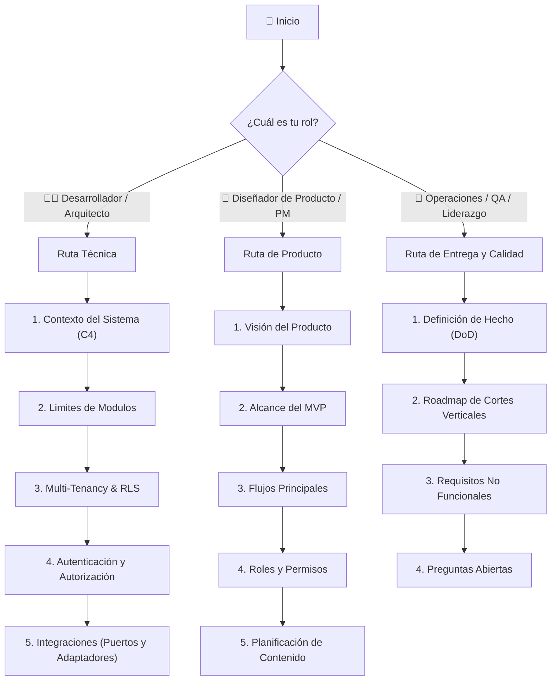

# 📚 Centro de Aprendizaje y Documentación de CRM

¡Bienvenido a la documentación oficial del sistema **CRM**!

Este centro de documentación ha sido diseñado bajo un **enfoque psicopedagógico** basado en _andamiaje cognitivo_, _modelos mentales intuitivos_, _teoría de codificación doble (texto + diagramas visuales)_ y _puntos de autocomprobación_.

---

## 🎯 ¿Cómo aprender en esta documentación?

Cada documento de este repositorio sigue una estructura diseñada para facilitar tu aprendizaje:

1. 🎯 **Objetivo de Aprendizaje**: Sabrás exactamente qué habilidades o conceptos dominarás al finalizar la lectura.
2. 💡 **Modelo Mental y Analogía**: Conectarás conceptos abstractos de software con situaciones reales e intuitivas.
3. 🗺️ **Explicación Paso a Paso**: Desglose claro y progresivo de las reglas de negocio y arquitectura.
4. 📊 **Material Visual Enriquecido**: Diagramas de flujo y secuencia en Mermaid para visualizar la interacción entre componentes.
5. ⚠️ **Mitos vs. Realidades / Errores Comunes**: Identificación temprana de malentendidos o fallos frecuentes.
6. 🧠 **Checkpoint de Autocomprobación**: Preguntas y escenarios prácticos para evaluar tu comprensión antes de escribir código o tomar decisiones de producto.

---

## 🗺️ Rutas de Aprendizaje Recomendadas

Selecciona tu perfil para seguir la ruta de lectura optimizada a tus necesidades:

---

## 🗂️ Índice General de la Documentación

### 📦 1. Producto y Negocio (`/product`)

- [Visión del Producto](product/vision.md) — Filosofía, mercado objetivo y qué es (y no es) el CRM.
- [Alcance del MVP](product/mvp-scope.md) — Características incluidas en la primera fase y delimitación del alcance.
- [Roles y Permisos](product/roles-and-permissions.md) — Matriz RBAC, ámbitos de plataforma vs. tenant y cliente final.
- [Flujos Principales](product/core-workflows.md) — Ciclos de vida (Prospecto a Cobro, Oportunidad a Proyecto, Cotización a Factura).
- [Gestión de Contactos y Cuentas](product/contact-and-account-management.md) — Directorio comercial, personas, empresas y métodos.
- [Planificación de Contenido](product/content-planning.md) — Fichas editoriales, flujo de aprobación de piezas y calendario.
- [Glosario](product/glossary.md) — Definiciones unificadas del lenguaje ubicuo del dominio.

### 🏛️ 2. Arquitectura Técnica (`/architecture`)

- [Contexto del Sistema](architecture/system-context.md) — Modelo C4, decisiones de stack (Next.js, Drizzle, PostgreSQL, Node.js).
- [Límites de Módulos](architecture/module-boundaries.md) — Monolito modular, comunicación entre subdominios y reglas de importación.
- [Multi-tenancy](architecture/multi-tenancy.md) — Aislamiento multiempresa, resolución de dominios y propagación del contexto.
- [Aislamiento de Datos Comerciales](architecture/business-data-isolation.md) — Row Level Security (RLS) en PostgreSQL y Drizzle.
- [Autenticación](architecture/authentication.md) — Better Auth, gestión de sesiones `httpOnly`, cookies y flujo de correo local.
- [Autorización](architecture/authorization.md) — Validación en servidor, modelo de seguridad y denegación por defecto.
- [Integraciones](architecture/integrations.md) — Patrón Puertos y Adaptadores (WhatsApp Meta/WAHA, Mercado Pago/Stripe, Storage).
- [Requisitos No Funcionales](architecture/non-functional-requirements.md) — Seguridad, rendimiento, límites de costos y observabilidad.

### 🎯 3. Decisiones de Arquitectura (`/decisions`)

- [ADR-001 Monolito Modular](decisions/ADR-001-modular-monolith.md)
- [ADR-002 PostgreSQL Fuente de Verdad](decisions/ADR-002-postgresql-source-of-truth.md)
- [ADR-003 Multi-tenancy](decisions/ADR-003-multi-tenancy.md)
- [ADR-004 Puertos y Adaptadores](decisions/ADR-004-ports-and-adapters.md)
- [ADR-005 Plataforma Next.js y Node](decisions/ADR-005-nextjs-node-platform.md)
- [ADR-006 pnpm y Runtime Node](decisions/ADR-006-pnpm-and-node-runtime.md)
- [ADR-007 Drizzle y Migraciones](decisions/ADR-007-drizzle-and-versioned-migrations.md)
- [ADR-008 Límite de Better Auth](decisions/ADR-008-better-auth-boundary.md)
- [ADR-009 Almacenamiento de Archivos](decisions/ADR-009-postgresql-and-file-storage.md)
- [ADR-010 Despliegue Piloto y Costo](decisions/ADR-010-pilot-deployment-and-cost.md)
- [ADR-011 Autenticación y Sesiones](decisions/ADR-011-authentication-and-session-policy.md)
- [ADR-014 Modelo de Directorio Comercial](decisions/ADR-014-commercial-directory-model.md)
- [ADR-015 RLS para Datos del Tenant](decisions/ADR-015-rls-for-tenant-business-data.md)

### 🚀 4. Entrega y Calidad (`/delivery`)

- [Roadmap](delivery/roadmap.md) — Plan de entregas por cortes verticales funcionales.
- [Definition of Done](delivery/definition-of-done.md) — Criterios de calidad, pruebas y documentación obligatorios.
- [Registro de Reutilización](delivery/reuse-register.md) — Componentes y patrones evaluados para reutilización.
- [Preguntas Abiertas](delivery/open-questions.md) — Bitácora de dudas de negocio e implementación por resolver.

---

## ⚡ Guía Rápida de Referencia

- **Regla de Oro de Seguridad**: Ninguna consulta o mutación debe confiar en un `tenant_id` enviado desde el cliente. El tenant se deriva estrictamente del contexto autenticado en servidor (dominio/sesión).
- **Patrón de Arquitectura**: Monolito modular con aislamiento estricto por PostgreSQL RLS y comunicación entre módulos mediante eventos/casos de uso.
- **Constitución**: Consulta siempre la [Constitución para Agentes](../AGENTS.md) antes de proponer cambios de código o arquitectura.
