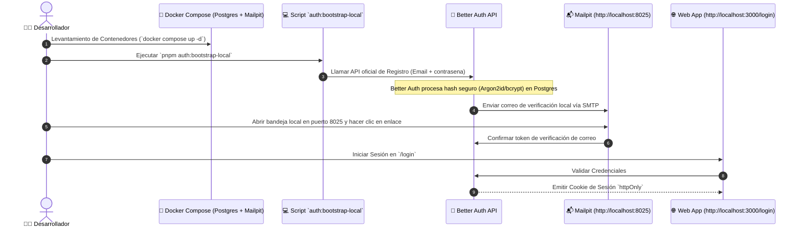

# 🔑 Autenticación (Better Auth & Gestión de Sesiones)

---

## 🎯 Objetivo de Aprendizaje

Al finalizar la lectura de este documento, serás capaz de:

1. Comprender la integración de **Better Auth** dentro del monolito modular sin acoplar el dominio de negocio.
2. Ejecutar y depurar el **Flujo Local de Autenticación** mediante Docker, Mailpit y scripts de bootstrap.
3. Explicar las políticas de seguridad de cookies (`httpOnly`), expiración y protección contra ataques CSRF / Origen cruzado.

---

## 💡 Modelo Mental y Analogía

> **El Control de Identidad en la Entrada del Edificio**  
> Piensa en la capa de autenticación como la **caseta de vigilancia en la entrada del edificio**:
>
> - **Better Auth**: Es el guardia de seguridad de la entrada principal. Verifica tu identificación (correo y contraseña), confirma que tu cuenta esté verificada y te entrega un gafete oficial impreso (**Cookie de sesión `httpOnly`**).
> - **Better Auth no decide a qué oficinas puedes entrar**: Una vez dentro del edificio, presentarás tu gafete al guardia de cada piso (**Módulos de Autorización y Tenant**), quien decidirá a cuáles oficinas tienes acceso.

---

## 🗺️ 1. Arquitectura del Módulo de Autenticación

Better Auth vive en la capa de infraestructura. Los servicios del dominio de negocio consumen abstracciones de sesión sin importar SDKs directos de Better Auth:

```mermaid
flowchart LR
    subgraph ClientLayer["🌐 Capa de Entrega Web"]
        Browser[📱 Navegador Web] --> NextRoutes["🚀 Next.js Route Handlers\n/api/auth/*"]
    end

    subgraph InfraLayer["🔌 Capa de Infraestructura"]
        NextRoutes --> BetterAuth[🔒 Better Auth Engine]
        BetterAuth --> DB[(🐘 PostgreSQL via Drizzle)]
        BetterAuth --> EmailPort[📧 EmailSender Port]
        EmailPort --> SMTPAdapter[✉️ Adaptador SMTP]
    end

    subgraph DevTools["🛠️ Entorno de Desarrollo"]
        SMTPAdapter --> Mailpit[📬 Mailpit Local (Port 8025)]
    end
```

---

## 🗺️ 2. Flujo Completo de Bootstrapping y Login Local

Para crear la primera identidad de pruebas en entorno local sin registro público habilitado:



---

## 🗺️ 3. Políticas de Sesión y Seguridad

- **Almacenamiento Seguro**: La sesión se conserva estrictamente en cookies con bandera `httpOnly`, `SameSite=Lax` (o `Strict`) y `Secure` en producción. **Nunca se almacena en `localStorage` ni `sessionStorage`** para prevenir vulnerabilidades XSS.
- **Duración y Renovación**: Las sesiones duran 7 días y se actualizan automáticamente cada 24 horas. El cierre de sesión (logout) invalida inmediatamente el registro de sesión en PostgreSQL.
- **Validación de Origen**: Se rechazan solicitudes con encabezados `Host` o `callbackURL` modificados. Los orígenes confiables se derivan estrictamente de las variables de entorno `BETTER_AUTH_URL` o `APP_BASE_URL`.
- **Protección contra Registro Público Descontrolado**: La variable `AUTH_BOOTSTRAP_ENABLED` debe permanecer en `false`. En producción el bootstrapping público está bloqueado a nivel de código aunque la variable esté activada accidentalmente.

---

## ⚠️ Mitos vs. Realidades / Errores Comunes

| ❌ Mito                                                                                                                           | ✅ Realidad                                                                                                                                                                                           |
| :-------------------------------------------------------------------------------------------------------------------------------- | :---------------------------------------------------------------------------------------------------------------------------------------------------------------------------------------------------- |
| **"Se pueden insertar registros directamente en la tabla de usuarios con contraseñas en texto plano para hacer pruebas rápido."** | **Falso.** Los usuarios de pruebas deben crearse mediante la API oficial de Better Auth o el script `auth:bootstrap-local` para garantizar la generación correcta del hash de contraseña.             |
| **"Better Auth decide si el usuario puede editar una cotización."**                                                               | **Falso.** Better Auth solo certifica **quién es el usuario** (autenticación). El módulo de autorización del CRM es el que valida si el rol del usuario en la empresa le permite editar cotizaciones. |

---

## 🧠 Checkpoint de Autocomprobación

1. **¿Dónde se visualizan los correos de verificación durante el desarrollo local sin enviar emails reales?**
   - _Respuesta_: En la interfaz web de Mailpit en `http://localhost:8025`.

2. **¿Por qué está prohibido guardar el token de sesión en `localStorage`?**
   - _Respuesta_: Porque cualquier script malicioso inyectado vía XSS en el navegador podría leer `localStorage` y robar el token. Las cookies `httpOnly` son inaccesibles desde el JavaScript del cliente.

---

## 🔗 Documentación Relacionada

- [Autorización](authorization.md)
- [ADR-008 Límite de Better Auth](../decisions/ADR-008-better-auth-boundary.md)
- [ADR-011 Autenticación y Sesiones](../decisions/ADR-011-authentication-and-session-policy.md)
