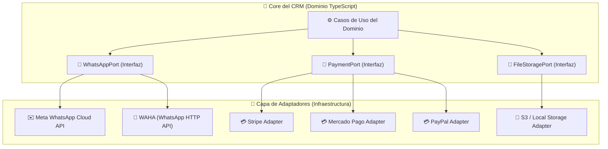
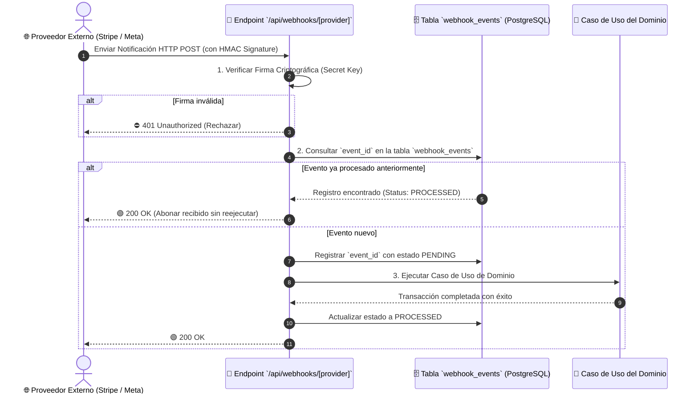

# 🔌 Integraciones (Puertos, Adaptadores & Webhooks)

---

## 🎯 Objetivo de Aprendizaje

Al finalizar la lectura de este documento, serás capaz de:

1. Comprender el patrón de arquitectura **Puertos y Adaptadores (Hexagonal Architecture)** aplicado a servicios externos.
2. Diseñar el flujo de recepción segura de **Webhooks** con verificación de firma y garantía de **Idempotencia**.
3. Explicar el desacoplamiento de servicios clave (WhatsApp Meta Cloud API vs. WAHA, Mercado Pago vs. Stripe, Storage S3).

---

## 💡 Modelo Mental y Analogía

> **El Adaptador de Corriente Universal de Viaje**  
> Piensa en los puertos y adaptadores como el **adaptador universal que llevas cuando viajas al extranjero**:
>
> - **El Puerto (`WhatsAppPort` / `PaymentPort`)**: Es el enchufe estándar de tu laptop. Tu laptop solo sabe conectarse a su conector hembra de 3 patas (interfaz de TypeScript en el Dominio).
> - **El Adaptador (`MetaWhatsAppAdapter` / `StripeAdapter`)**: Es el conector físico que cambia de enchufe según el país (EE.UU., Europa, Japón). Si cambias de proveedor de pasarela, solo cambias la clavija del adaptador; **tu laptop (el core del CRM) ni se entera del cambio**.

---

## 🗺️ 1. Diagrama de Puertos y Adaptadores

---

## 🗺️ 2. Flujo Integrado de Recepción de Webhooks Idempotentes

Para procesar notificaciones entrantes de terceros (ej. cobro recibido de Mercado Pago o mensaje entrante de WhatsApp) sin duplicar datos si el proveedor reintenta el envío:

---

## 🗺️ 3. Reglas Principales de Integración

1. **Credenciales Cifradas**: Los secretos y llaves API de cada proveedor se almacenan cifrados en base de datos por `tenant_id`. NUNCA se escriben en logs ni se exponen en respuestas API.
2. **Modelo de Dominio Unificado**: El proveedor externo no impone su modelo de datos. Stripe o Mercado Pago entregan eventos de pasarela, pero el CRM los traduce al modelo unificado `PaymentRecorded`.
3. **Sin Custodia de Fondos**: El dinero de los cobros ingresa directamente a las cuentas bancarias de la agencia. CRM solo registra la conciliación.
4. **Manejo de Archivos Binarios**: Los archivos (PDFs, imágenes, entregables) viven fuera de PostgreSQL (en S3 o File Storage). La base de datos solo almacena metadatos, tenant, URL signed y permisos.

---

## ⚠️ Mitos vs. Realidades / Errores Comunes

| ❌ Mito                                                                                                      | ✅ Realidad                                                                                                                                                  |
| :----------------------------------------------------------------------------------------------------------- | :----------------------------------------------------------------------------------------------------------------------------------------------------------- |
| **"Si WhatsApp envía el mismo webhook 3 veces por problemas de red, se registrarán 3 mensajes duplicados."** | **Falso.** Gracias a la tabla de idempotencia, el segundo y tercer intento reconocen el `event_id` existente y retornan `200 OK` sin reejecutar la mutación. |
| **"Los archivos subidos se guardan como blobs en la base de datos PostgreSQL."**                             | **Falso.** PostgreSQL solo almacena metadatos y referencias. Guardar binarios en la base de datos degrada el rendimiento y encarece los backups.             |

---

## 🧠 Checkpoint de Autocomprobación

1. **¿Qué sucede si se cambia de Meta WhatsApp Cloud API a WAHA para el conector de mensajería?**
   - _Respuesta_: Solamente se cambia la implementación del adaptador en la capa de infraestructura. El módulo de conversaciones del dominio no sufre ningún cambio.

2. **¿Cuál es el primer paso obligatorio al recibir un Webhook entrante en un endpoint HTTP?**
   - _Respuesta_: Validar la firma criptográfica (HMAC) de la petición para garantizar que proviene legítimamente del proveedor.

---

## 🔗 Documentación Relacionada

- [Limites de Módulos](module-boundaries.md)
- [ADR-004 Puertos y Adaptadores](../decisions/ADR-004-ports-and-adapters.md)
- [ADR-009 Almacenamiento de Archivos](../decisions/ADR-009-postgresql-and-file-storage.md)
