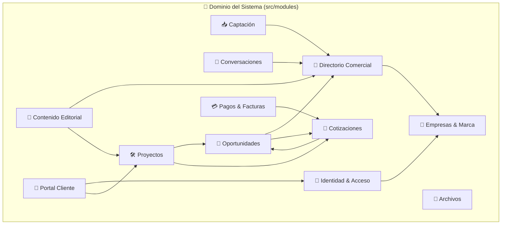

# 🧱 Límites de Módulos (Modular Monolith Boundaries)

---

## 🎯 Objetivo de Aprendizaje

Al finalizar la lectura de este documento, serás capaz de:

1. Comprender la estructura de subdominios del **Monolito Modular** y sus responsabilidades.
2. Aplicar las **reglas de acoplamiento y dependencias permitidas** entre módulos.
3. Evitar importaciones circulares y fuga de abstracciones hacia la capa de presentación (Next.js) o persistencia.

---

## 💡 Modelo Mental y Analogía

> **El Conjunto de Departamentos en un Edificio de Oficinas**  
> Piensa en los módulos del CRM como **departamentos especializados dentro de una empresa**:
>
> - **Departamento de Recursos Humanos (Identidad)**: Conoce a los empleados y sus gafetes.
> - **Departamento de Ventas (Oportunidades)**: Maneja los prospectos y cotizaciones.
> - **Ventanilla de Envíos (Integraciones)**: Envía mensajes por correo o WhatsApp.
>
> Ningún departamento entra a revisar los archivos físicos guardados bajo llave en el escritorio del otro departamento. Se comunican solicitando servicios por ventanilla oficial o enviando memorándums (eventos internos).

---

## 🗺️ 1. Matriz de Módulos y Dependencias Permitidas



---

## 🗺️ 2. Tabla Definitiva de Responsabilidades por Módulo

| Módulo                   | Responsabilidad y Datos                                   | Servicios y Eventos Publicados                  | Dependencias Permitidas                |
| :----------------------- | :-------------------------------------------------------- | :---------------------------------------------- | :------------------------------------- |
| **Identidad y Acceso**   | Usuarios, sesiones, roles y membresías.                   | `autenticar`, `autorizar`, `membership.changed` | Empresas, Auditoría                    |
| **Empresas y Marca**     | Tenants, dominios, branding y configuración.              | `resolverTenant`, `tenant.updated`              | Identidad, Auditoría                   |
| **Directorio Comercial** | Contactos, cuentas, métodos, etiquetas y consentimientos. | `buscarContacto`, `contact.updated`             | Empresas, Identidad                    |
| **Captación**            | Formularios, fuentes de origen y atribución.              | `recibirLead`, `lead.created`                   | Directorio, Integraciones              |
| **Conversaciones**       | Hilos, participantes, mensajes y entregas.                | `enviarMensaje`, `message.received`             | Directorio, Integraciones, Archivos    |
| **Oportunidades**        | Pipelines, etapas, oportunidades y actividades.           | `ganarOportunidad`, `opportunity.won`           | Directorio, Cotizaciones               |
| **Contenido**            | Ideas, notas, fichas, versiones y aprobación.             | `transicionarEstado`, `content.submitted`       | Directorio, Proyectos, Archivos        |
| **Cotizaciones**         | Cotizaciones, líneas de ítem, snapshots y aprobación.     | `aprobarCotizacion`, `quote.approved`           | Directorio, Oportunidades              |
| **Proyectos**            | Plantillas, proyectos, tareas y entregables.              | `activarProyecto`, `project.activated`          | Oportunidades, Cotizaciones, Contenido |
| **Archivos**             | Metadatos de archivos, visibilidad y permisos.            | `subirArchivo`, `descargarArchivo`              | Todos los módulos mediante puertos     |
| **Pagos y Facturas**     | Pagos, conciliación, webhooks y facturas externas.        | `conciliarPago`, `payment.recorded`             | Cotizaciones, Integraciones            |
| **Portal**               | Proyección restringida de vistas para el cliente.         | `solicitarVoBo`, `aprobarPieza`                 | Identidad, Proyectos, Archivos         |

---

## 🗺️ 3. Reglas de Estructura de Directorios

```text
src/
  ├── app/                 # Capa de entrega Web (Next.js App Router: UI, Server Components, API routes)
  ├── modules/             # Límites de negocio (Casos de uso, entidades y lógica de dominio pura)
  ├── shared/              # Contratos compartidos y utilidades transversales estrictamente necesarias
  └── infrastructure/      # Adaptadores técnicos (Drizzle, Better Auth, Mailpit, S3, Pasarelas)
```

> 🔒 **Regla de Separación**: El código dentro de `src/modules/` es **código TypeScript puro**. No debe importar `React`, `Next.js`, `Drizzle ORM` ni SDKs de proveedores externos.

---

## ⚠️ Mitos vs. Realidades / Errores Comunes

| ❌ Mito                                                                                      | ✅ Realidad                                                                                                                                                      |
| :------------------------------------------------------------------------------------------- | :--------------------------------------------------------------------------------------------------------------------------------------------------------------- |
| **"Un módulo puede hacer un JOIN directo a las tablas de la base de datos de otro módulo."** | **Falso.** Los repositorios son privados de cada módulo. La comunicación entre módulos se realiza exclusivamente mediante Servicios de Dominio o Eventos.        |
| **"Better Auth maneja la tabla de contactos del cliente."**                                  | **Falso.** Better Auth vive en `infrastructure` e `identity` para autenticación de usuarios. El directorio comercial vive aisladamente en el módulo `directory`. |

---

## 🧠 Checkpoint de Autocomprobación

1. **¿Qué sucede si el módulo de `Proyectos` necesita notificar al módulo de `Conversaciones` sobre la creación de una nueva tarea?**
   - _Respuesta_: Emite un evento interno (`task.created`) a través de la infraestructura compartida de eventos, evitando importar directamente el módulo de conversaciones.

2. **¿Puede el módulo de `Dominio` importar componentes de React o helpers de Next.js?**
   - _Respuesta_: No. La capa de dominio es agnóstica a la capa de entrega/web.

---

## 🔗 Documentación Relacionada

- [Contexto del Sistema](system-context.md)
- [ADR-001 Monolito Modular](../decisions/ADR-001-modular-monolith.md)
