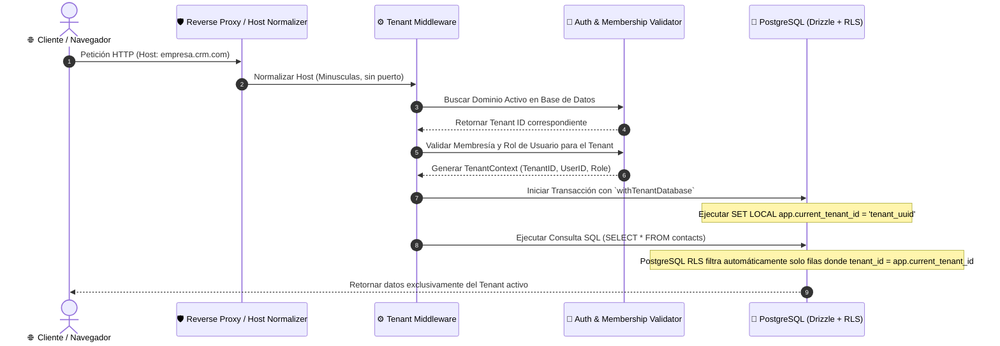
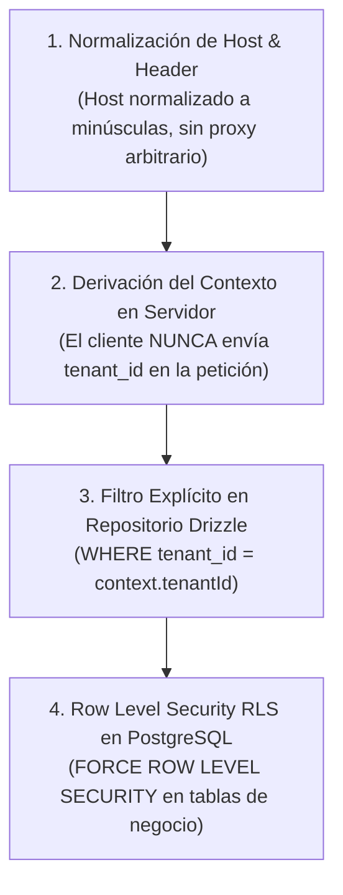

# 🏢 Multi-tenancy (Resolución y Aislamiento Multiempresa)

---

## 🎯 Objetivo de Aprendizaje

Al finalizar la lectura de este documento, serás capaz de:

1. Comprender la arquitectura de **Multi-tenancy** basada en un solo esquema con aislamiento estricto por `tenant_id`.
2. Tracear la secuencia completa de **resolución del Tenant** a partir del hostname/dominio y las credenciales.
3. Explicar el funcionamiento de la barrera de seguridad de doble capa (Filtro explícito + Row Level Security en PostgreSQL).

---

## 💡 Modelo Mental y Analogía

> **El Hotel de Lujo con Tarjetas de Habitación Programadas**  
> Piensa en la arquitectura multi-tenant como un **hotel de lujo donde operan distintas empresas**:
>
> - **Un solo edificio (Misma base de datos)**: Todas las empresas comparten los cimientos y elevadores (infraestructura).
> - **Cerradura electrónica en cada puerta (RLS en PostgreSQL)**: La tarjeta de acceso del Huésped A (`tenant_id = A`) **no abre ni desbloquea la puerta** de la suite del Huésped B (`tenant_id = B`), aunque intenten forzar la cerradura.
> - **Recepción (Middleware de resolución)**: Al llegar a la recepción (`agencia.midominio.com`), el recepcionista verifica tu reservación y te asigna la tarjeta codificada exclusivamente para tu suite.

---

## 🗺️ 1. Flujo de Resolución del Tenant desde la Petición HTTP



---

## 🗺️ 2. Capas de Seguridad en Profundidad (Defense in Depth)

El aislamiento multiempresa implementa un enfoque de **Defensa en Profundidad** con 4 barreras secuenciales:



---

## 🗺️ 3. Reglas Técnicas de Ejecución

1. **Normalización del Hostname**: El hostname se convierte a minúsculas, retirando el puerto y puntos finales. Solo se aceptan dominios explícitamente verificados o el dominio administrativo de respaldo.
2. **Contexto Autenticado Inmutable**: El servidor **nunca acepta un `tenant_id` enviado libremente por el cliente** en el body o query params. El tenant se deriva estrictamente del dominio, la sesión de Better Auth, la API Key o el webhook firmado.
3. **Identidad del Runtime**: El runtime de la aplicación se conecta a la base de datos usando el rol `crm_runtime`, mientras que las migraciones usan `crm_migration`. Las tablas de negocio tienen habilitado `FORCE ROW LEVEL SECURITY`.
4. **Transaccionalidad con `withTenantDatabase`**: Toda operación en base de datos ejecuta la variable de sesión de PostgreSQL:
   ```sql
   SET LOCAL app.current_tenant_id = 'uuid-del-tenant';
   ```

---

## ⚠️ Mitos vs. Realidades / Errores Comunes

| ❌ Mito                                                                                              | ✅ Realidad                                                                                                                                                             |
| :--------------------------------------------------------------------------------------------------- | :---------------------------------------------------------------------------------------------------------------------------------------------------------------------- |
| **"Un cliente puede enviar `?tenantId=123` en la URL para cambiar de empresa."**                     | **Falso.** El parámetro `tenantId` en la petición es ignorado. El tenant se resuelve en servidor mediante el hostname o la sesión autenticada.                          |
| **"Si me olvido de poner `.where(eq(table.tenantId, tenantId))` en la consulta, se fugarán datos."** | **Falso.** Gracias a RLS (`FORCE ROW LEVEL SECURITY`), PostgreSQL bloqueará cualquier fila que no corresponda al `app.current_tenant_id` establecido en la transacción. |

---

## 🧠 Checkpoint de Autocomprobación

1. **¿Qué sucede si un usuario intenta consultar directamente una cotización de otro tenant mediante un ID inventado (Ataque IDOR)?**
   - _Respuesta_: La consulta regresa un resultado vacío (`404 Not Found`), ya que PostgreSQL RLS filtra la fila antes de ser retornada al repositorio.

2. **¿Cuál es la diferencia entre los roles de base de datos `crm_runtime` y `crm_migration`?**
   - _Respuesta_: `crm_runtime` es el usuario de la aplicación sujeto a las políticas de RLS; `crm_migration` es el usuario administrador utilizado para aplicar migraciones de esquema en Drizzle.

---

## 🔗 Documentación Relacionada

- [Aislamiento de Datos Comerciales](business-data-isolation.md)
- [ADR-003 Multi-tenancy](../decisions/ADR-003-multi-tenancy.md)
- [ADR-015 RLS para Datos del Tenant](../decisions/ADR-015-rls-for-tenant-business-data.md)
