# 📊 Requisitos No Funcionales (NFRs & Calidad)

---

## 🎯 Objetivo de Aprendizaje

Al finalizar la lectura de este documento, serás capaz de:

1. Comprender la matriz de **Requisitos No Funcionales (NFRs)** del MVP y sus metas verificables.
2. Ejecutar la suite completa de **comandos de verificación de calidad** local y en CI.
3. Explicar las políticas de observabilidad, accesibilidad y presupuestos de infraestructura para el entorno piloto.

---

## 💡 Modelo Mental y Analogía

> **El Control de Calidad y Seguridad de una Nave Espacial**  
> Piensa en los NFRs como los **sensores e indicadores del panel de control de un vehículo espacial**:
>
> - **Requisitos Funcionales**: Dicen a dónde va la nave (Vender, cotizar, aprobar contenido).
> - **Requisitos No Funcionales (NFRs)**: Garantizan que el oxígeno no se agote (Seguridad), el casco no sufra fugas (Aislamiento Multi-tenant), la nave responda al instante al piloto (Rendimiento) y no se consuma más combustible del presupuestado (Límite de costos <= $500 MXN/mes).

---

## 🗺️ 1. Matriz Verificable de NFRs

| Área               | MVP Verificable (Criterio de Aceptación)                                                                      | Fase Posterior                                                |
| :----------------- | :------------------------------------------------------------------------------------------------------------ | :------------------------------------------------------------ |
| **Seguridad**      | Secretos fuera de Git; validación estricta de esquemas; autorización en servidor; webhooks firmados HMAC.     | Rotación automatizada con AWS KMS / HashiCorp Vault.          |
| **Aislamiento**    | Pruebas automatizadas cross-tenant en cada módulo; RLS obligatorio en tablas de negocio.                      | Separación de bases de datos físicas por cliente enterprise.  |
| **Disponibilidad** | Recuperación documentada en entorno piloto sin compromiso de SLA estricto.                                    | Réplicas de lectura, failover automatizado y métricas Uptime. |
| **Rendimiento**    | Consultas paginadas obligatorias; webhooks responden HTTP 200 en < 500ms.                                     | Caching distribuido con Redis y workers desacoplados.         |
| **Accesibilidad**  | Navegación accesible por teclado, contraste alto, labels explícitos y alternativa al drag-and-drop.           | Auditoría automatizada WCAG 2.1 AA completa.                  |
| **Respaldos**      | Scripts de backup automático diario para PostgreSQL y metadatos de archivos; prueba de restauración validada. | Políticas formales RPO < 1h y RTO < 4h.                       |
| **Auditoría**      | Registro de cambios en permisos, dominios, secretos, pagos y aprobaciones en tabla `audit_logs`.              | Alertas en tiempo real y exportación a SIEM centralizado.     |
| **Observabilidad** | Request ID propagado en cada petición; logs estructurados en JSON sin PII ni credenciales.                    | Trazado distribuido con OpenTelemetry / APM.                  |
| **Presupuesto**    | Costo de infraestructura piloto de las 2-3 empresas de la fase inicial <= $500 MXN/mes.                       | Escalado automático por consumo multi-región.                 |

---

## 🗺️ 2. Pipeline Ejecutable de Calidad Local y CI

Para certificar que un cambio de código está listo para integrarse al repositorio, se deben ejecutar y aprobar secuencialmente los siguientes comandos de calidad:

```mermaid
flowchart LR
    Start[💻 Cambios Locales] --> Format["1. pnpm format:check\n(Estilo de código)"]
    Format --> Lint["2. pnpm lint\n(ESLint estricto)"]
    Lint --> TypeCheck["3. pnpm typecheck\n(Tipado TypeScript)"]
    TypeCheck --> UnitTest["4. pnpm test:run\n(Pruebas unitarias)"]
    UnitTest --> DBCheck["5. pnpm db:check\n(Verificación Drizzle)"]
    DBCheck --> Build["6. pnpm build\n(Compilación Next.js)"]
    Build --> Pass[🟢 Ready for PR / Merge]
```



### Comandos de Verificación en Consola

```bash
# 1. Verificar formato de archivos
pnpm format:check

# 2. Análisis estático de código
pnpm lint

# 3. Verificación de tipos sin emitir JS
pnpm typecheck

# 4. Suite de pruebas unitarias e integración
pnpm test:run

# 5. Cobertura de pruebas
pnpm test:coverage

# 6. Verificación de esquemas de base de datos
pnpm db:check

# 7. Compilación de producción de Next.js
pnpm build
```

---

## ⚠️ Mitos vs. Realidades / Errores Comunes

| ❌ Mito                                                                                            | ✅ Realidad                                                                                                                                     |
| :------------------------------------------------------------------------------------------------- | :---------------------------------------------------------------------------------------------------------------------------------------------- |
| **"Se pueden imprimir los argumentos de las funciones en los logs para facilitar la depuración."** | **Falso.** Los logs no deben incluir Información de Identificación Personal (PII), contraseñas, secretos ni tokens por normativas de seguridad. |
| **"Un build exitoso de Next.js significa que el código no tiene errores de TypeScript."**          | **Falso.** El comando `pnpm typecheck` explícito es el único que evalúa exhaustivamente todo el árbol de tipos del proyecto en modo estricto.   |

---

## 🧠 Checkpoint de Autocomprobación

1. **¿Qué comando ejecuta la suite completa de análisis de tipos de TypeScript en el proyecto?**
   - _Respuesta_: `pnpm typecheck`.

2. **¿Cuál es el límite presupuestario mensual fijado para la infraestructura del entorno piloto?**
   - _Respuesta_: Un costo total menor o igual a $500 MXN/mes.

---

## 🔗 Documentación Relacionada

- [Definition of Done](../delivery/definition-of-done.md)
- [ADR-010 Despliegue Piloto y Costo](../decisions/ADR-010-pilot-deployment-and-cost.md)
