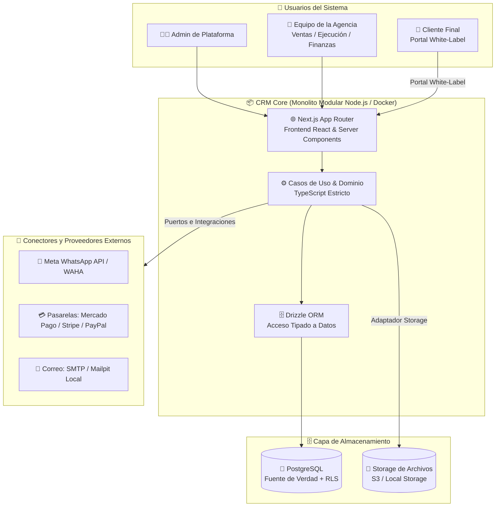
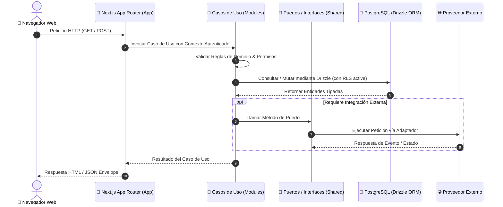

# 🏛️ Contexto del Sistema (System Context C4)

---

## 🎯 Objetivo de Aprendizaje

Al finalizar la lectura de este documento, serás capaz de:

1. Comprender la posición del sistema **CRM** dentro de su ecosistema técnico y los actores que interactúan con él.
2. Identificar el stack tecnológico oficial (Next.js App Router, TypeScript, Drizzle ORM, PostgreSQL, Better Auth).
3. Explicar el principio de **desacoplamiento de infraestructura** mediante contenedores y adaptadores.

---

## 💡 Modelo Mental y Analogía

> **El Centro Comercial con Tiendas y Edificio Administrativo**  
> Piensa en la arquitectura del sistema como un **centro comercial inteligente**:
>
> - **PostgreSQL**: La bóveda de seguridad central ubicada en el subterráneo. Guarda todas las mercancías e inventarios de cada tienda en cajas fuertes etiquetadas por inquilino.
> - **Next.js App Router**: La estructura física del edificio. Atiende tanto a los clientes que entran a los locales (UI Web) como a los camiones de carga que entregan mercancía (API Endpoints).
> - **Puertos y Adaptadores**: Los tomacorrientes universales. Permiten conectar diferentes electrodomésticos (Stripe, WhatsApp, Mailpit) sin cambiar la instalación eléctrica del edificio.

---

## 🗺️ 1. Diagrama C4 Nivel 1: Contexto del Sistema

El siguiente diagrama ilustra los usuarios principales, las fronteras del CRM y los sistemas externos integrados:

---

## 🗺️ 2. Flujo de Solicitudes y Capas Técnicas

---

## 🗺️ 3. Principios de Arquitectura Confirmados

1. **Monolito Modular**: Ejecutado como un único proceso servidor Node.js en contenedor Docker, evitando la sobrecomplejidad de microservicios o Kubernetes en el MVP.
2. **PostgreSQL Fuente de Verdad**: Mantiene todas las transacciones, permisos, auditoría y metadatos con Row Level Security (RLS).
3. **Build Seguro**: La aplicación no abre conexiones a base de datos durante la fase de compilación (`next build`) ni expone credenciales en el cliente web.
4. **Límites de Custodia**: CRM conserva estado de negocio, pero **no custodia fondos** ni reemplaza la contabilidad de la empresa.

---

## ⚠️ Mitos vs. Realidades / Errores Comunes

| ❌ Mito                                                                              | ✅ Realidad                                                                                                                                                |
| :----------------------------------------------------------------------------------- | :--------------------------------------------------------------------------------------------------------------------------------------------------------- |
| **"Necesitamos Redis y colas de mensajes distribuidas para poder arrancar el MVP."** | **Falso.** El monolito modular gestiona tareas en segundo plano mediante jobs y transacciones en PostgreSQL sin agregar complejidad operativa innecesaria. |
| **"Next.js App Router debe contener toda la lógica de negocio en Server Actions."**  | **Falso.** Next.js es la capa de entrega/UI. La lógica de negocio reside en los _módulos de dominio_ desacoplados de los frameworks web.                   |

---

## 🧠 Checkpoint de Autocomprobación

1. **¿Qué tecnología gestiona el acceso tipado a la base de datos PostgreSQL?**
   - _Respuesta_: Drizzle ORM.

2. **¿Por qué la comunicación con pasarelas de pago y mensajería se realiza a través de Puertos y Adaptadores?**
   - _Respuesta_: Para que el core del CRM no dependa directamente de la API específica de Stripe o Meta, permitiendo intercambiar proveedores sin alterar las reglas de negocio.

---

## 🔗 Documentación Relacionada

- [Límites de Módulos](module-boundaries.md)
- [Multi-tenancy](multi-tenancy.md)
- [ADR-001 Monolito Modular](../decisions/ADR-001-modular-monolith.md)
