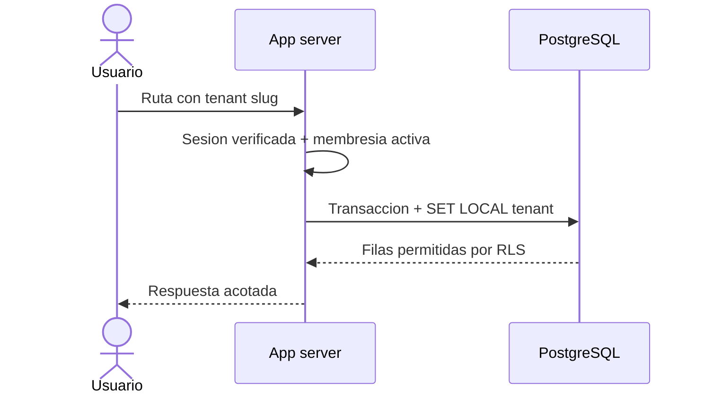

# ADR-012: Contexto de tenant y aislamiento de datos

## Estado

Aceptada

## Decision

El tenant se resuelve en servidor a partir de la ruta y la membresia activa del usuario. Cada operacion de datos tenant-owned usa `withTenantDatabase`, que establece `SET LOCAL app.current_tenant_id` dentro de una transaccion. Los repositorios tambien filtran por tenant cuando el caso de uso lo requiere.

PostgreSQL aplica una segunda barrera: las tablas tenant-owned tienen RLS habilitado y forzado, con politicas que comparan `tenant_id` contra `current_setting('app.current_tenant_id', true)`. `crm_runtime`, `crm_worker`, `crm_ingress` y `crm_test_runtime` no son superusuarios ni tienen `BYPASSRLS`; las migraciones usan una credencial separada.

El administrador de plataforma no recibe acceso automatico a datos de negocio. Solo obtiene acceso tenant mediante una membresia valida.

## Flujo

## Consecuencias

- Un slug, ID o `tenant_id` enviado por el cliente no puede conceder acceso.
- Una consulta sin contexto no debe devolver datos tenant-owned.
- Las conexiones de runtime deben conservar privilegio minimo.
- RLS requiere pruebas de migracion, aislamiento y contexto ausente.
