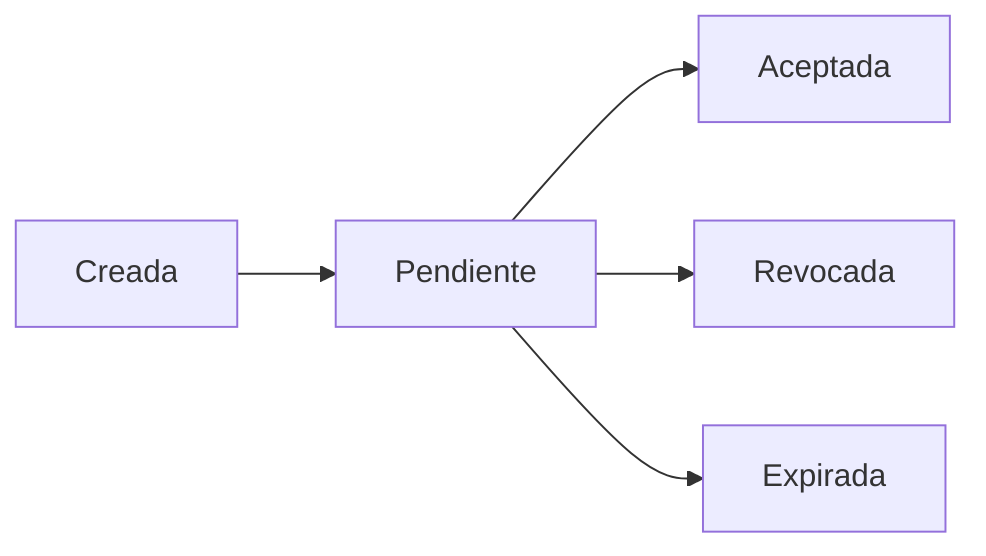

# ADR-013: RBAC, membresias e invitaciones

## Estado

Aceptada

## Decision

Better Auth administra la identidad global, correo, credenciales y sesiones. CRM administra tenants, membresias, roles e invitaciones. Una identidad puede tener varias membresias, pero cada par usuario-tenant tiene una sola membresia.

Los roles son fijos: `tenant_admin`, `sales`, `execution`, `finance` y `client`. `client` es mutuamente excluyente con roles internos. Los permisos se calculan en servidor con denegacion por defecto; ocultar controles en la interfaz no es una barrera de seguridad.

Las invitaciones almacenan un hash de token, expiran como maximo en siete dias y solo pueden aceptarse para el correo verificado correspondiente. La aceptacion se ejecuta en una transaccion bloqueada y es idempotente para el mismo usuario.

## Ciclo de invitacion

## Consecuencias

- Plataforma y tenant permanecen separados.
- Suspender tenant o membresia bloquea el siguiente request.
- No se eliminan fisicamente membresias con historial.
- La regla de ultimo administrador se valida en el servidor y bajo bloqueo.
