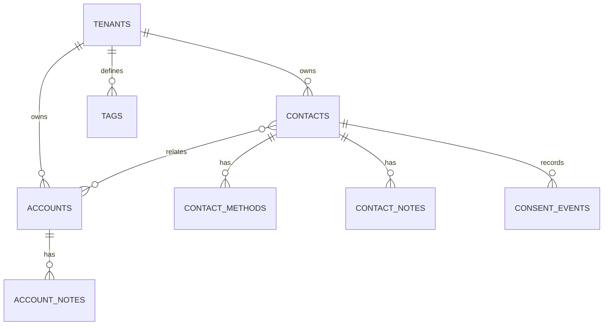

# ADR-014: Directorio comercial explicito

## Estado

Aceptada

## Decision

El modulo `commercial-directory` separa `crm_contacts` y `crm_accounts`. Los contactos no son usuarios de Better Auth y las cuentas no son tenants. La relacion contacto-cuenta es muchos-a-muchos. Correos, telefonos y WhatsApp viven en `crm_contact_methods`; sus valores normalizados no son unicos entre contactos. Duplicados generan advertencias, no bloqueos absolutos.

Notas tienen tablas separadas por entidad para conservar foreign keys reales. Las preferencias de comunicacion son eventos append-only y el estado ausente es `unknown`. Los registros se archivan, nunca se eliminan desde la aplicacion, y contactos/cuentas usan `version` para concurrencia optimista.

## Alternativas descartadas

- Usar la tabla `user` como directorio.
- Una relacion polimorfica sin foreign keys para notas y etiquetas.
- Unicidad global de correo o telefono.
- Convertir contactos en prospectos o clientes mediante estados artificiales.

## Riesgos y revision

La fusion de duplicados y campos personalizados quedan pendientes. Revisar antes de importaciones masivas o pipelines.

## Fuentes consultadas

- https://orm.drizzle.team/docs/transactions
- https://orm.drizzle.team/docs/indexes-constraints
- https://www.postgresql.org/docs/current/ddl-constraints.html
