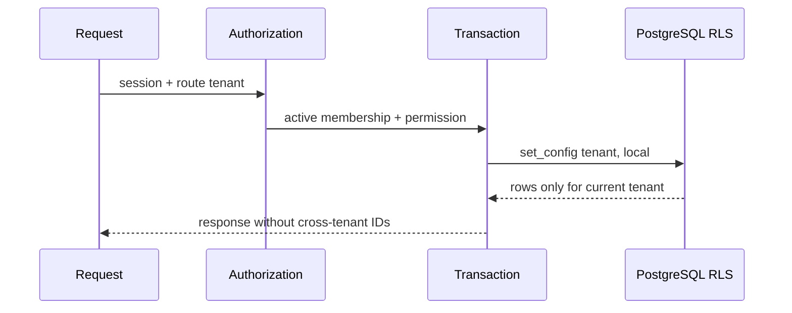

# ADR-015: RLS para datos comerciales tenant-owned

## Estado

Aceptada

## Decision

El rol `crm_migration` es propietario de tablas y ejecuta Drizzle Kit mediante `DATABASE_MIGRATION_URL`. El servidor usa `DATABASE_URL` con `crm_runtime`, que es `NOSUPERUSER`, no tiene `BYPASSRLS` y no es propietario de tablas comerciales. El runtime recibe solo grants DML explicitos.

Cada tabla comercial tiene `tenant_id NOT NULL`, `ENABLE ROW LEVEL SECURITY`, `FORCE ROW LEVEL SECURITY` y politicas separadas para SELECT, INSERT, UPDATE y DELETE. Las politicas comparan `tenant_id` con `current_setting('app.current_tenant_id', true)`. La ausencia del setting produce cero acceso.

`withTenantDatabase` abre una transaccion, establece el setting con `set_config(..., true)` parametrizado y ejecuta el repositorio en la misma conexion. El setting se limpia al terminar la transaccion y no se conserva entre requests del pool. Los repositorios tambien filtran explicitamente por tenant.

## Pruebas obligatorias

- Sin contexto el runtime no lee ni escribe datos comerciales.
- Tenant A no ve filas de tenant B.
- `WITH CHECK` rechaza insertar o mover una fila de B bajo A.
- `current_user`, propietario y `rolbypassrls` se verifican.
- Dos transacciones consecutivas del pool no comparten el setting.

## Fuentes consultadas

- https://www.postgresql.org/docs/current/ddl-rowsecurity.html
- https://www.postgresql.org/docs/current/sql-set-config.html
- https://orm.drizzle.team/docs/transactions
