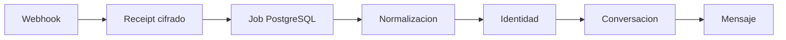

# ADR-018: Modelo canónico de bandeja unificada

## Estado

Aceptada

## Decision

Los proveedores convierten mensajes entrantes a `NormalizedInboundEvent`. El módulo inbox conserva conexiones, identidades, conversaciones, mensajes y estados usando IDs externos acotados por conexión y tenant. Los adaptadores no escriben directamente en la interfaz ni exponen secretos.

Los duplicados se rechazan con claves únicas e idempotency keys. La identidad ambigua no se vincula arbitrariamente y el contacto se crea solo dentro del tenant resuelto.
