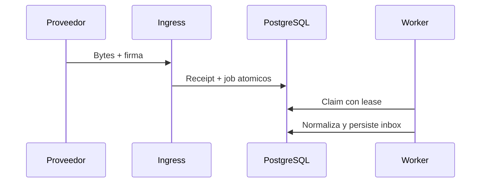

# ADR-019: Ingress de webhooks y jobs PostgreSQL

## Estado

Aceptada

El ingress lee el body como bytes, limita su tamaño, resuelve la ruta pública, valida firma antes de parsear y guarda receipt cifrado más job en una transacción. El worker usa una conexión separada sin `BYPASSRLS`, establece el tenant, reclama jobs con `FOR UPDATE SKIP LOCKED` y leases recuperables, y aplica backoff/dead-letter.

