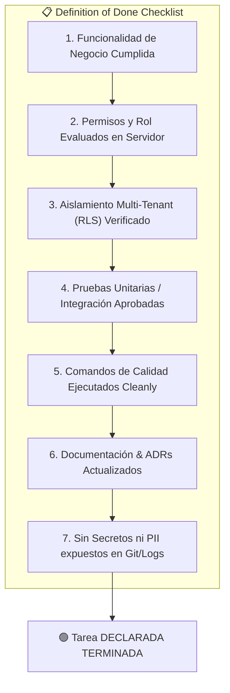

# ✅ Definition of Done (Criterios de Aceptación y Calidad)

---

## 🎯 Objetivo de Aprendizaje

Al finalizar la lectura de este documento, serás capaz de:

1. Conocer la lista de verificación obligatoria que todo cambio de código o funcionalidad debe superar antes de considerarse terminado.
2. Aplicar los criterios de **Seguridad, Aislamiento Multi-tenant, Pruebas y Accesibilidad**.
3. Mantener la consistencia del repositorio cumpliendo las normas establecidas en la Constitución para Agentes (`AGENTS.md`).

---

## 💡 Modelo Mental y Analogía

> **La Inspección Técnica Antes del Despegue de un Avión**  
> Piensa en la _Definition of Done (DoD)_ como la **lista de comprobación técnica del piloto antes de despegar**:
>
> - No basta con encender los motores (programar la función).
> - Hay que revisar los frenos (Pruebas unitarias), el nivel de combustible (Verificación de tipos TypeScript), las puertas herméticas (Aislamiento RLS multi-tenant) y el plan de vuelo actualizado (Documentación). Si falta un solo elemento de la lista, el avión **no despega**.

---

## 🗺️ 1. Lista de Comprobación Definitiva (DoD Checklist)

---

## 🗺️ 2. Detalles por Categoría de Aceptación

### 🔒 1. Seguridad y Aislamiento Multi-tenant

- [ ] La tabla de negocio incluye la columna `tenant_id NOT NULL`.
- [ ] Se habilitó y forzó Row Level Security: `ALTER TABLE ... FORCE ROW LEVEL SECURITY`.
- [ ] Todas las mutaciones y consultas en servidor utilizan `withTenantDatabase`.
- [ ] No existe ninguna ruta o Server Action que acepte un `tenant_id` enviado libremente desde el cliente.
- [ ] Las peticiones a recursos de otro tenant retornan estado `404 Not Found`.

### 🧪 2. Pruebas y Cobertura

- [ ] Se agregaron pruebas unitarias para los casos de uso principales.
- [ ] Se incluyó una prueba de aislamiento cross-tenant (verificando que el Tenant B no pueda leer datos del Tenant A).
- [ ] La suite completa de pruebas pasa sin errores: `pnpm test:run`.

### 🎨 3. Interfaz de Usuario y Accesibilidad

- [ ] Todos los elementos interactivos cuentan con IDs únicos y accesibles para pruebas E2E.
- [ ] Es posible navegar y operar las vistas usando únicamente el teclado.
- [ ] Existen estados visuales claros para: **Carga (Loading)**, **Sin datos (Empty state)** y **Manejo de Errores (Error boundary)**.
- [ ] Se ofrece una alternativa accesible para componentes con drag-and-drop.

### 📚 4. Documentación y Limpieza

- [ ] Se actualizaron los documentos afectados en `docs/`.
- [ ] Si se tomó una decisión estructural significativa, se registró el ADR correspondiente en `docs/decisions/`.
- [ ] Los comandos `pnpm format:check`, `pnpm lint`, `pnpm typecheck` y `pnpm build` ejecutan sin advertencias ni errores.

---

## ⚠️ Mitos vs. Realidades / Errores Comunes

| ❌ Mito                                                                                     | ✅ Realidad                                                                                                                                              |
| :------------------------------------------------------------------------------------------ | :------------------------------------------------------------------------------------------------------------------------------------------------------- |
| **"Si el código funciona en mi máquina local, ya puedo declarar la tarea como terminada."** | **Falso.** No se declara terminada una tarea hasta que pasa los 7 puntos de la lista DoD, incluyendo `pnpm build` y pruebas de aislamiento cross-tenant. |
| **"Las pruebas de accesibilidad se pueden dejar para una fase posterior."**                 | **Falso.** La accesibilidad de teclado, contraste y manejo de errores se valida desde la primera entrega visual de cada componente.                      |

---

## 🧠 Checkpoint de Autocomprobación

1. **¿Qué sucede si un PR incluye una nueva tabla de negocio pero olvida aplicar RLS en PostgreSQL?**
   - _Respuesta_: El PR no cumple la Definition of Done y no debe fusionarse hasta agregar `FORCE ROW LEVEL SECURITY` y la política correspondiente.

2. **¿Cuáles son los 4 comandos de consola obligatorios para validar calidad antes de marcar un trabajo como terminado?**
   - _Respuesta_: `pnpm format:check`, `pnpm lint`, `pnpm typecheck`, `pnpm test:run` y `pnpm build`.

---

## 🔗 Documentación Relacionada

- [Requisitos No Funcionales](../architecture/non-functional-requirements.md)
- [Roadmap](roadmap.md)
- [Constitución para Agentes](../../AGENTS.md)
