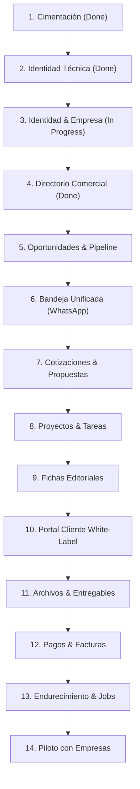

# 🗺️ Roadmap de Entregas (Cortes Verticales Funcionales)

---

## 🎯 Objetivo de Aprendizaje

Al finalizar la lectura de este documento, serás capaz de:

1. Entender la metodología de **Cortes Verticales Funcionales** para el desarrollo progresivo del CRM.
2. Identificar el estado actual del desarrollo (Fases completadas vs. siguientes fases).
3. Evaluar los criterios de demostración de valor y seguridad exigidos en cada hito del roadmap.

---

## 💡 Modelo Mental y Analogía

> **La Construcción del Pastel de Bodas por Rebanadas**  
> Piensa en los cortes verticales como **cortar una rebanada completa de un pastel de varias capas**:
>
> - **Corte Horizontal (Incorrecto)**: Construir primero todos los cimientos de la base de datos durante 3 meses sin tener ninguna pantalla visible. Es como hornear solo el pan y no probar si la crema y la fruta combinan bien.
> - **Corte Vertical (Correcto)**: Construir una rebanada completa que incluye pan, relleno, crema y adorno (UI + Lógica + Base de Datos + Pruebas + Permisos) para una sola funcionalidad (ej. Identidad o Directorio Comercial). Permite probar y entregar valor real de negocio en cada paso.

---

## 🗺️ 1. Flujo Progresivo de Cortes Verticales

---

## 🗺️ 2. Tabla Detallada del Roadmap

| Corte                       | Objetivo y Demostración de Valor                       | Datos y Permisos               | Pruebas y Criterio de Aceptación         | Estado         |
| :-------------------------- | :----------------------------------------------------- | :----------------------------- | :--------------------------------------- | :------------- |
| **1. Cimentación**          | Documentación de arquitectura y entorno ejecutable.    | Sin datos de negocio.          | Repositorio y docs iniciales validadas.  | 🟢 Completada  |
| **2. Identidad Técnica**    | Auth básica con correo, verificación y sesiones.       | Usuarios técnicos sin tenant.  | E2E autenticado con Mailpit local.       | 🟢 Completada  |
| **3. Identidad y Empresa**  | Estructura de Tenant, miembros, roles y dominios.      | Tenants, Memberships, Domains. | Verificación de aislamiento de roles.    | 🟡 En progreso |
| **4. Directorio Comercial** | Registrar contactos, cuentas y relaciones.             | Contacts, Accounts, Methods.   | Aislamiento RLS, búsqueda y duplicados.  | 🟢 Completada  |
| **5. Oportunidades**        | Pipelines, etapas y avance de prospectos.              | Opportunities, Pipelines.      | Conversión de contacto a venta.          | ⏳ Pendiente   |
| **6. Bandeja Unificada**    | Recibir y responder mensajes por WhatsApp.             | Conversations, Messages.       | Firma webhook, idempotencia y errores.   | ⏳ Pendiente   |
| **7. Cotización**           | Crear, aprobar y vincular cotizaciones.                | Quotes, Snapshots.             | Autorización de clientes y finanzas.     | ⏳ Pendiente   |
| **8. Proyecto**             | Crear proyecto borrador y activarlo con condicionales. | Projects, Tasks, Templates.    | Venta ganada genera tablero de trabajo.  | ⏳ Pendiente   |
| **9. Editorial**            | Ideas, briefs, piezas y calendario.                    | ContentItems, Notes.           | Ficha enviada a revisión en portal.      | ⏳ Pendiente   |
| **10. Portal Cliente**      | Vistas restringidas para clientes finales.             | Shared Resources.              | Pruebas anti-IDOR y sin fugas internas.  | ⏳ Pendiente   |
| **11. Archivos**            | Subida y entrega auditada de archivos.                 | FileMetadata, Storage.         | Descarga auditada y permisos RLS.        | ⏳ Pendiente   |
| **12. Pagos**               | Registrar pago y conciliar facturas.                   | Payments, Invoices.            | Sin duplicar conciliaciones vía webhook. | ⏳ Pendiente   |
| **13. Endurecimiento**      | Jobs de recordatorios y conectores extra.              | Jobs, Integrations.            | Reintentos e idempotencia probados.      | ⏳ Pendiente   |
| **14. Piloto Operativo**    | Operación real con 2-3 empresas piloto.                | Datos reales controlados.      | Backups, soporte y monitoreo activo.     | ⏳ Pendiente   |

---

## ⚠️ Mitos vs. Realidades / Errores Comunes

| ❌ Mito                                                                                                         | ✅ Realidad                                                                                                                                               |
| :-------------------------------------------------------------------------------------------------------------- | :-------------------------------------------------------------------------------------------------------------------------------------------------------- |
| **"Podemos saltar las pruebas de aislamiento multi-tenant en la fase de Oportunidades y agregarlas al final."** | **Falso.** Cada corte vertical debe incluir sus pruebas de permisos y aislamiento antes de declararse como completado.                                    |
| **"Un corte vertical solo incluye la pantalla de la interfaz de usuario."**                                     | **Falso.** Incluye la UI, los endpoints de API, la lógica de dominio, la base de datos con RLS, las pruebas automatizadas y la documentación actualizada. |

---

## 🧠 Checkpoint de Autocomprobación

1. **¿Qué fases del roadmap se encuentran actualmente completadas en el repositorio?**
   - _Respuesta_: Las fases 1 (Cimentación), 2 (Identidad Técnica) y 4 (Directorio Comercial).

2. **¿Cuál es la siguiente fase funcional a desarrollar según la secuencia del roadmap?**
   - _Respuesta_: La Fase 5 (Oportunidades y Pipeline de Ventas).

---

## 🔗 Documentación Relacionada

- [Definition of Done](definition-of-done.md)
- [Alcance del MVP](../product/mvp-scope.md)
