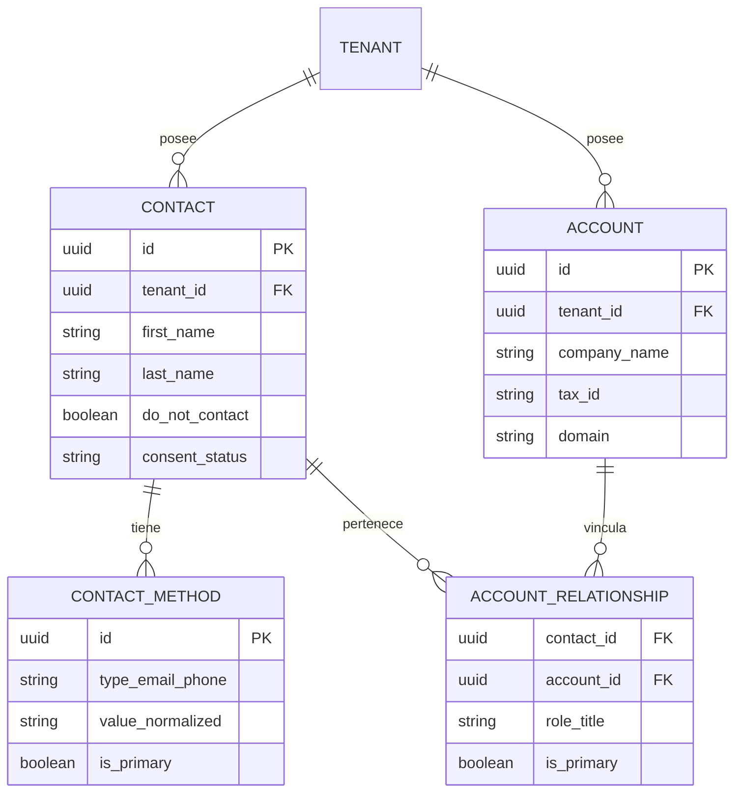
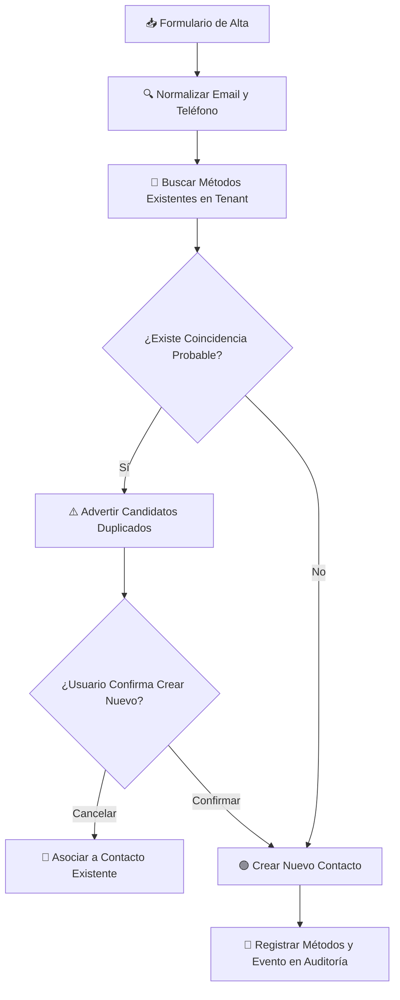

# 👥 Gestión de Contactos y Cuentas (Directorio Comercial)

---

## 🎯 Objetivo de Aprendizaje

Al finalizar la lectura de este documento, serás capaz de:

1. Diseñar el modelo de relaciones entre **Personas (Contactos)** y **Empresas (Cuentas Comercial)**.
2. Aplicar el algoritmo de normalización y detección de **duplicados probables**.
3. Implementar el manejo del consentimiento de comunicación (`do_not_contact`).

---

## 💡 Modelo Mental y Analogía

> **La Libreta de Direcciones Centralizada de la Agencia**  
> Imagina el directorio comercial como la **agenda telefónica inteligente de una empresa**:
>
> - **Contacto (Persona)**: "María López", directora de marketing. Puede trabajar en una empresa hoy y cambiar a otra mañana, pero conserva sus datos personales.
> - **Cuenta (Organización)**: "Tech Corp", la empresa cliente.
> - **Relación**: Conecta a María con Tech Corp bajo el cargo "Directora de Mapeo". María también puede ser consejera en otra empresa sin duplicar su ficha de persona.

---

## 🗺️ 1. Modelo de Entidades y Relaciones

---

## 🗺️ 2. Flujo de Alta y Detección de Duplicados

Para evitar contaminar el directorio con registros duplicados (ej. "Juan Pérez" vs "juan.perez@gmail.com"), el sistema sigue una compuerta estricta:

---

## 🗺️ 3. Reglas Principales de Dominio

1. **Aislamiento Multi-tenant**: Toda persona, empresa o método pertenece estrictamente al `tenant_id` activo. Nunca se comparten contactos entre agencias.
2. **Normalización de Métodos**: Los correos se convierten a minúsculas y los teléfonos al formato E.164 (ej. `+525512345678`).
3. **Método Primario Único**: Un contacto solo puede poseer **un** correo primario y **un** teléfono primario.
4. **Bandera `do_not_contact`**: Si está activa (`true`), prevalece sobre cualquier automatización, campaña o envío de mensajes en la bandeja.
5. **Sin Consentimiento por Defecto**: La ausencia de consentimiento explícito equivale a `unknown` (no autorizado), nunca a autorización implícita. Las notas internas no constituyen evidencia de consentimiento legal.

---

## ⚠️ Mitos vs. Realidades / Errores Comunes

| ❌ Mito                                                                                  | ✅ Realidad                                                                                                                                                 |
| :--------------------------------------------------------------------------------------- | :---------------------------------------------------------------------------------------------------------------------------------------------------------- |
| **"Si un cliente borra un contacto, se elimina definitivamente la fila de PostgreSQL."** | **Falso.** Los contactos se **archivan** (soft delete) para preservar la integridad referencial en facturas y auditoría.                                    |
| **"Better Auth es la base de datos de los contactos del CRM."**                          | **Falso.** Better Auth administra la autenticación de usuarios de la plataforma/agencia. Los contactos comerciales viven en la tabla de negocio `contacts`. |

---

## 🧠 Checkpoint de Autocomprobación

1. **¿Qué sucede si se intenta enviar un mensaje por WhatsApp a un contacto con `do_not_contact = true`?**
   - _Respuesta_: El sistema bloquea el envío de inmediato en la capa de dominio, rechazando el comando antes de tocar la API de WhatsApp.

2. **¿Puede existir un Contacto registrado sin ninguna Cuenta (Empresa) asociada?**
   - _Respuesta_: Sí. Un contacto puede existir de forma independiente en el directorio comercial antes de vincularse a una cuenta o venta.

---

## 🔗 Documentación Relacionada

- [Flujos Principales](core-workflows.md)
- [Roles y Permisos](roles-and-permissions.md)
- [ADR-014 Modelo de Directorio Comercial](../decisions/ADR-014-commercial-directory-model.md)
