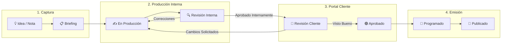
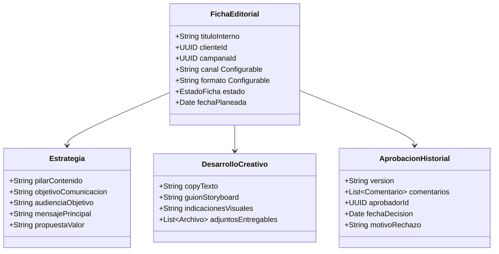

# 🎨 Planificación de Contenido Editorial

---

## 🎯 Objetivo de Aprendizaje

Al finalizar la lectura de este documento, serás capaz de:

1. Diseñar el flujo de trabajo de piezas de contenido desde la **captura de una idea** hasta su **publicación**.
2. Explicar la diferencia entre una **Nota Interna** y una **Ficha Editorial**.
3. Definir la visibilidad de los contenidos en el **Portal del Cliente** según el estado de aprobación.

---

## 💡 Modelo Mental y Analogía

> **La Redacción de un Periódico o Revista Digital**  
> Piensa en el módulo de contenido como la mesa de redacción de una editorial:
>
> 1. **Mesa de Lluvia de Ideas (Backlog / Notas)**: Cualquier miembro puede anotar ideas sueltas o referentes en una servilleta virtual. No son públicas.
> 2. **Mesa de Redacción y Diseño (En Producción)**: El copywriter redacta el texto y el diseñador adjunta la pieza visual.
> 3. **Editor Jefe (Revisión Interna)**: El líder de la agencia revisa que la pieza cumpla con la marca y el brief.
> 4. **Aprobación del Cliente (Portal Cliente)**: Se envía la prueba de impresión digital al cliente para su visto bueno.
> 5. **Imprenta / Emisión (Programado / Publicado)**: La pieza se marca como lista para emitirse en el calendario.

---

## 🗺️ 1. Flujo de Estados de una Ficha Editorial

---

## 🗺️ 2. Estructura de Campos de la Ficha Editorial

Para garantizar que cada entrega tenga rigor estratégico, la ficha se organiza en 5 bloques:

---

## 🗺️ 3. Transición de Notas a Fichas Editoriales

- **Nota Rapida / Idea**: Contiene título, texto libre, adjuntos opcionales y visibilidad restringida. Permanece independiente o puede convertirse en Ficha Editorial con 1-clic sin duplicar datos.
- **Aislamiento en Portal**: Una ficha en estado `idea`, `brief` o `en_produccion` **nunca es visible para el cliente**. Solo las fichas explicitamente enviadas a `en_revision_cliente` se exponen en el Portal del Cliente.

---

## ⚠️ Mitos vs. Realidades / Errores Comunes

| ❌ Mito                                                                                              | ✅ Realidad                                                                                                              |
| :--------------------------------------------------------------------------------------------------- | :----------------------------------------------------------------------------------------------------------------------- |
| **"Si muevo una ficha en el calendario, el sistema publicará automáticamente la foto en Facebook."** | **Falso.** El drag-and-drop en el calendario actualiza la `fechaPlaneada`. La publicación automática está fuera del MVP. |
| **"Las notas de lluvia de ideas son visibles para el cliente de la marca."**                         | **Falso.** Las notas son texto plano interno y solo el personal autorizado de la agencia puede leerlas.                  |

---

## 🧠 Checkpoint de Autocomprobación

1. **¿Qué sucede si un cliente rechaza una pieza en el portal solicitando un ajuste en los colores?**
   - _Respuesta_: La ficha pasa del estado `en_revision_cliente` a `cambios_solicitados` (con el motivo registrado) y regresa a `en_produccion` para el diseñador.

2. **¿Se requiere drag-and-drop obligatorio para mover fechas en el calendario?**
   - _Respuesta_: No. El drag-and-drop es opcional y el sistema cuenta con formularios accesibles para editar fechas mediante teclado o selectores estándar.

---

## 🔗 Documentación Relacionada

- [Flujos Principales](core-workflows.md)
- [Roles y Permisos](roles-and-permissions.md)
