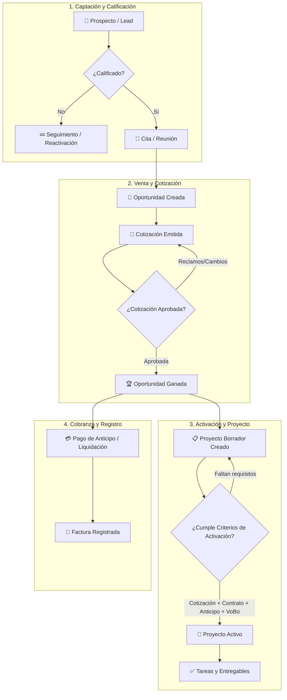
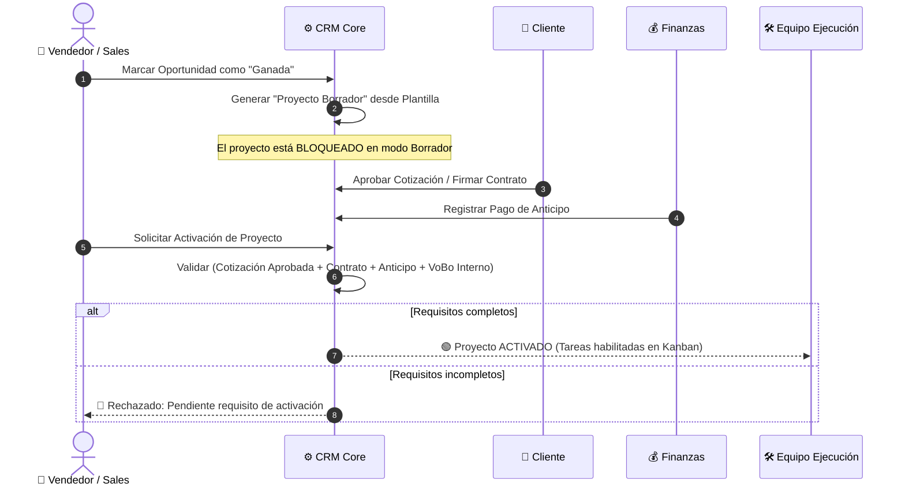
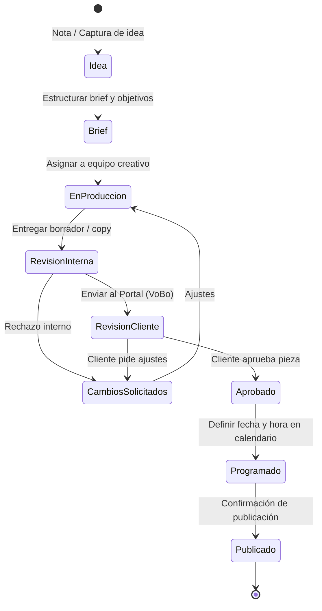

# 🔄 Flujos Principales del Sistema (Core Workflows)

---

## 🎯 Objetivo de Aprendizaje

Al finalizar la lectura de este documento, serás capaz de:

1. Comprender el ciclo de vida completo desde la **captación de un prospecto** hasta la **activación de un proyecto** y **registro de facturación**.
2. Explicar los criterios y condiciones requeridas para que una **oportunidad ganada** active un proyecto en borrador.
3. Modelar el flujo de **aprobación de contenido editorial** con clientes finales a través del portal white-label.

---

## 💡 Modelo Mental y Analogía

> **La Reacción en Cadena de un Negocio de Servicios**  
> Piensa en los flujos principales del CRM como una **cadena de producción industrial en un taller especializado**:
>
> 1. **Directorio Comercial (Materia prima)**: Llega una tarjeta de presentación (Contacto) o se registra una empresa (Cuenta).
> 2. **Pipeline de Ventas (Diseño)**: El prospecto muestra interés, se cotiza la solución y se llega a un acuerdo.
> 3. **Activación de Entregables (Fabricación)**: Una vez que el cliente aprueba la propuesta y paga el anticipo, la máquina de ejecución (Proyecto/Tareas) se enciende automáticamente.
> 4. **Canal Editorial (Comunicación)**: El contenido o los entregables pasan por control de calidad interno antes de presentarse al cliente.

---

## 🗺️ 1. Flujo Integrado: Prospecto a Proyecto y Facturación

El directorio comercial precede a las oportunidades: primero se registra una persona o cuenta, y posteriormente se relacionan. No se agregan etapas de venta sin un contacto registrado.

### 📊 Diagrama del Ciclo de Vida Comercial y Operativo

---

## 🗺️ 2. Reglas de Activación de Proyecto

Una oportunidad ganada **no genera trabajo activo de forma descontrolada**. Para evitar iniciar proyectos sin cobro o alcance confirmado, la plataforma impone la siguiente compuerta de validación:

---

## 🗺️ 3. Flujo Editorial y Gestión de Contenido

El módulo editorial permite planificar, producir y aprobar contenido (redes, piezas gráficas, artículos) sin depender de hojas de cálculo externas.

### 📊 Diagrama de Estados de Ficha Editorial

---

## ⚠️ Mitos vs. Realidades / Errores Comunes

| ❌ Mito / Error Común                                                        | ✅ Realidad en el CRM                                                                                                                             |
| :--------------------------------------------------------------------------- | :------------------------------------------------------------------------------------------------------------------------------------------------ |
| **"Cualquier venta ganada activa automáticamente un proyecto con tareas."**  | **Falso.** El proyecto se crea en modo _Borrador_. Solo se activa al confirmar la firma/contrato, pago de anticipo y VoBo interno.                |
| **"El cliente puede ver los borradores de contenido mientras se producen."** | **Falso.** El cliente en su portal _únicamente_ ve fichas editoriales en estado `en_revision_cliente`. Las notas e ideas internas están aisladas. |
| **"Un contacto se crea automáticamente al ganar una venta."**                | **Falso.** El directorio comercial precede la venta. El contacto/cuenta debe existir y asociarse a la oportunidad antes de pasar a cotización.    |

---

## 🧠 Checkpoint de Autocomprobación

1. **Escenario Práctico**: Un miembro del equipo de ventas marca una oportunidad de $50,000 MXN como "Ganada". El diseñador intenta mover las tareas al tablero Kanban pero el sistema se lo impide. ¿Cuál es la causa más probable?
   - _A)_ El diseñador no tiene rol `platform_admin`.
   - _B)_ El proyecto se encuentra en estado `Borrador` a la espera de confirmación de pago de anticipo y aprobación interna.
   - _C)_ El cliente rechazó el acceso al portal.
   - _(Respuesta correcta: B)_

2. **Pregunta de Control de Flujo**: ¿En qué estado del flujo editorial una pieza gráfica pasa a ser visible para el usuario en el Portal del Cliente?
   - _Respuesta_: Exclusivamente cuando la ficha transiciona al estado `en_revision_cliente`.

---

## 🔗 Documentación Relacionada

- [Visión del Producto](vision.md)
- [Planificación de Contenido](content-planning.md)
- [Roles y Permisos](roles-and-permissions.md)
