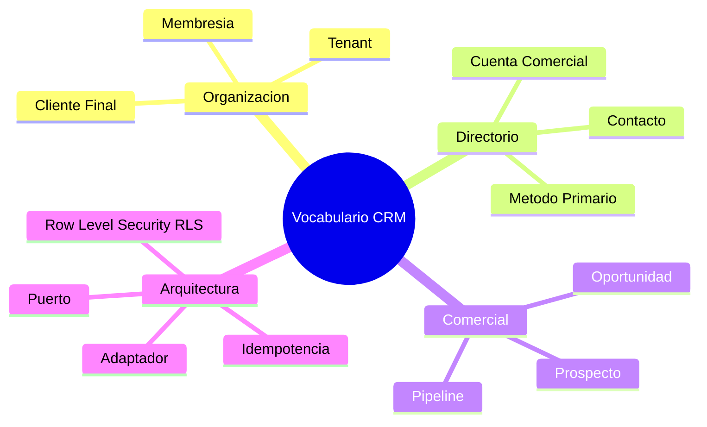

# 📖 Glosario Unificado del Dominio (Ubiquitous Language)

---

## 🎯 Objetivo de Aprendizaje

Al finalizar la lectura de este documento, contarás con un **vocabulario técnico y de negocio unificado** para comunicarte sin ambigüedades con el equipo de desarrollo, diseñadores de producto y partes interesadas.

---

## 💡 Modelo Mental y Analogía

> **El Diccionario del Lenguaje Ubicuo (Domain-Driven Design)**  
> En el desarrollo de software, la mayor causa de errores no son los bugs de sintaxis, sino la **confusión de términos** (ej. confundir un _Usuario_ que inicia sesión en el sistema con un _Contacto_ del directorio comercial). Este glosario establece la definición oficial de cada término dentro del repositorio.

---

## 🗂️ Términos Centrales del Dominio

---

## 📚 Diccionario Termiológico

| Término                 | Categoría    | Definición Oficial en CRM                                                                                                                      |
| :---------------------- | :----------- | :--------------------------------------------------------------------------------------------------------------------------------------------- |
| **Tenant**              | Organización | Empresa o agencia independiente que opera en la plataforma con sus propios datos, branding, dominio y aislamiento de seguridad.                |
| **Cliente Final**       | Organización | Persona u organización atendida por la agencia, autorizada únicamente para acceder al Portal White-Label.                                      |
| **Membresía**           | Identidad    | Registro que vincula a un Usuario del sistema con un Tenant específico, asignándole un Rol (`sales`, `delivery`, `finance`, etc.).             |
| **Cuenta Comercial**    | Directorio   | Empresa u organización registrada como cliente o prospecto dentro del directorio de un tenant.                                                 |
| **Contacto**            | Directorio   | Persona registrada en el directorio de un tenant. **No es un usuario autenticado** del sistema salvo que tenga acceso al portal.               |
| **Método Primario**     | Directorio   | Canal preferido de comunicación (ej. el correo principal o teléfono móvil E.164) dentro de la ficha de un contacto.                            |
| **Prospecto (Lead)**    | Ventas       | Contacto con potencial comercial que aún no ha iniciado una oportunidad formal de venta.                                                       |
| **Oportunidad**         | Ventas       | Negociación comercial activa con monto estimado, etapa en el pipeline, responsable y fecha proyectada de cierre.                               |
| **Pipeline**            | Ventas       | Secuencia configurable de etapas por las que avanza una oportunidad desde la prospección hasta el cierre.                                      |
| **Puerto (Port)**       | Arquitectura | Interfaz de software en la capa de dominio que define operaciones sin acoplarse a proveedores externos (ej. `PaymentPort`).                    |
| **Adaptador (Adapter)** | Arquitectura | Implementación técnica concreta de un puerto para interactuar con una tecnología externa (ej. `StripeAdapter`).                                |
| **Idempotencia**        | Arquitectura | Propiedad que garantiza que procesar el mismo evento o webhook múltiples veces produzca exactamente el mismo resultado sin duplicar registros. |
| **Row Level Security**  | Seguridad    | Mecanismo de PostgreSQL (RLS) que filtra automáticamente filas en la base de datos basándose en el `tenant_id` de la sesión actual.            |
| **Nota Interna**        | Operaciones  | Comentario de texto libre visible únicamente para el equipo autorizado de la agencia; nunca se expone al cliente final.                        |
| **Snapshot**            | Comercio     | Copia estática e inmutable de los datos de una cotización o contrato en el momento exacto de su aprobación.                                    |

---

## 🧠 Checkpoint de Autocomprobación

1. **¿Cuál es la diferencia técnica entre un _Usuario_ y un _Contacto_?**
   - _Respuesta_: Un **Usuario** es una cuenta con credenciales (Better Auth) que puede iniciar sesión en la plataforma. Un **Contacto** es un registro de persona física dentro del directorio comercial de una agencia para fines de prospección y atención.

2. **¿Por qué una Cotización aprobada genera un _Snapshot_?**
   - _Respuesta_: Para garantizar inmutabilidad histórica. Si los precios del catálogo cambian en el futuro, la cotización aprobada mantiene exactamente los precios originales acordados.

---

## 🔗 Documentación Relacionada

- [Visión del Producto](vision.md)
- [Limites de Módulos](../architecture/module-boundaries.md)
