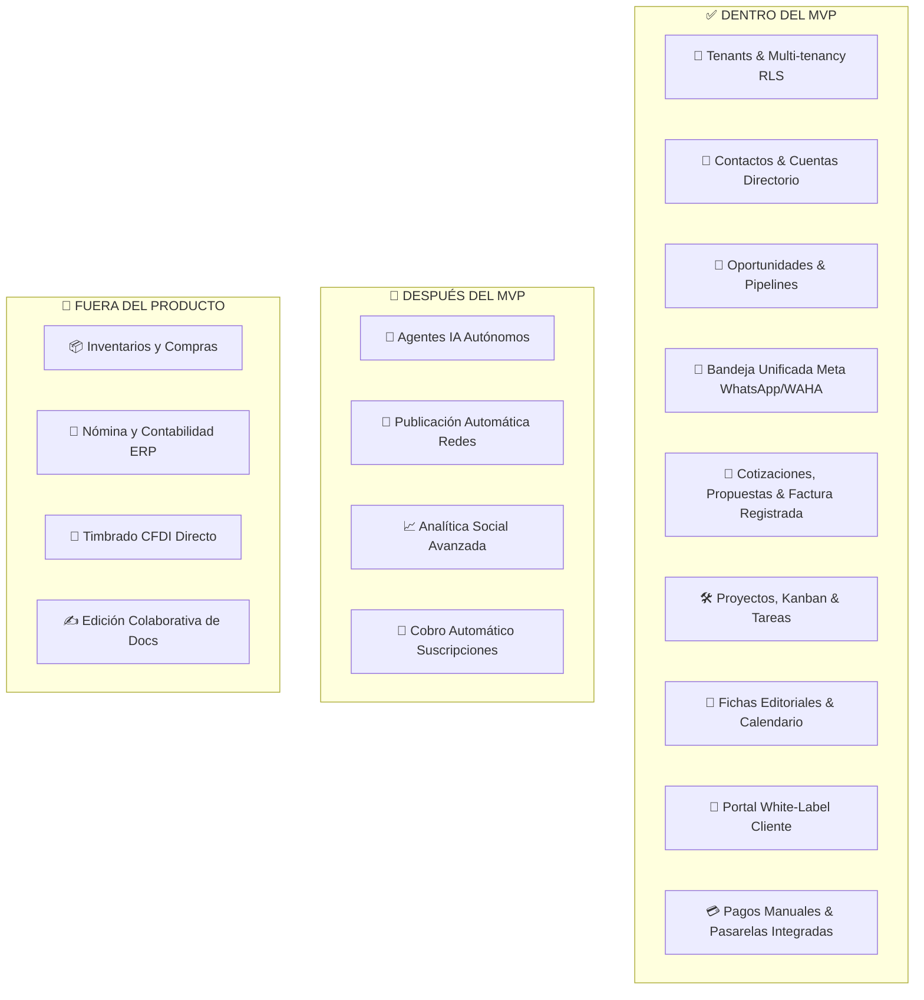

# 📦 Alcance del MVP (Minimum Viable Product)

---

## 🎯 Objetivo de Aprendizaje

Al finalizar la lectura de este documento, serás capaz de:

1. Identificar las funcionalidades esenciales comprometidas para la primera versión funcional del CRM.
2. Distinguir las capacidades diferidas para la fase Post-MVP y las definitivamente excluidas del producto.
3. Explicar los criterios de aceptación y calidad que debe cumplir cualquier nueva característica para incorporarse al MVP.

---

## 💡 Modelo Mental y Analogía

> **El Avión Comercial Seguro vs. El Jet Lleno de Lujos**  
> El MVP no es un producto incompleto ni defectuoso; es un **avión de pasajeros con motores certificados, alas sólidas y cabina presurizada**:
>
> - **Dentro del MVP**: Despegar, volar con seguridad a su destino, asientos cómodos y comunicación por radio (Ventas, Entregables, Portal de Clientes, Multi-tenancy RLS).
> - **Post-MVP**: Pantallas con juegos individuales y servicio de bar gourmet (Publicación automática en redes, IA autónoma).
> - **Fuera del Producto**: Convertir el avión en un submarino o camión de carga (Nómina, compras, inventario o ERP general).

---

## 🗺️ 1. Desglose del Alcance por Módulo

---

## 🗺️ 2. Matriz Detallada de Capacidades

### 🏢 Identidad, Tenants y Seguridad

- **Dentro**: Creación manual de tenants, branding (logo/colores), dominio personalizado, RBAC, auditoría y aislamiento de datos RLS en PostgreSQL.
- **Fuera**: Autoregistro público autónomo con cobro automático de membresía de plataforma.

### 👥 Directorio Comercial y Captación

- **Dentro**: Alta de contactos y cuentas, relaciones, normalización de correo/teléfono, detección de duplicados probables, atribución y formularios de captación.
- **Fuera**: Fusión automática de contactos sin confirmación humana.

### 💬 Conversaciones y Mensajería

- **Dentro**: Bandeja unificada multi-canal con primer conector (Meta WhatsApp Cloud API / WAHA).
- **Fuera**: Bots de respuesta automática enviando mensajes a clientes sin intervención de un operador humano.

### 📄 Cotizaciones y Proyectos

- **Dentro**: Cotización con ítems, PDF/vista web, aprobación digital por cliente, activación de proyecto borrador al recibir pago/contrato y tablero Kanban.
- **Fuera**: Firma electrónica avanzada con validez legal certificada (e.g. DocuSign) y editor WYSIWYG de contratos en tiempo real.

---

## ⚠️ Mitos vs. Realidades / Errores Comunes

| ❌ Mito                                                                         | ✅ Realidad                                                                                                                                                |
| :------------------------------------------------------------------------------ | :--------------------------------------------------------------------------------------------------------------------------------------------------------- |
| **"Si una función es útil para las ventas, entra automáticamente al MVP."**     | **Falso.** Solo entra si cuenta con historia demostrable, esquema de permisos, aislamiento cross-tenant probado y un criterio de aceptación en el Roadmap. |
| **"El cliente podrá editar el archivo PDF de la cotización dentro de la app."** | **Falso.** La edición colaborativa de documentos está fuera del alcance. Las cotizaciones se generan como snapshots inmutables.                            |

---

## 🧠 Checkpoint de Autocomprobación

1. **¿Por qué la publicación automática en redes sociales no forma parte del MVP?**
   - _Respuesta_: Porque el foco primario del MVP es consolidar el flujo operativo interno (brief, producción, revisión interna y aprobación del cliente) antes de depender de APIs cambiantes de redes sociales.

2. **¿Cuál es el criterio obligatorio para declarar que una característica ha entrado oficialmente al MVP?**
   - _Respuesta_: Debe contar con permisos evaluados en backend, aislamiento multi-tenant RLS, pruebas unitarias/integración y cumplir el Definition of Done.

---

## 🔗 Documentación Relacionada

- [Visión del Producto](vision.md)
- [Roadmap de Entregas](../delivery/roadmap.md)
- [Definition of Done](../delivery/definition-of-done.md)
