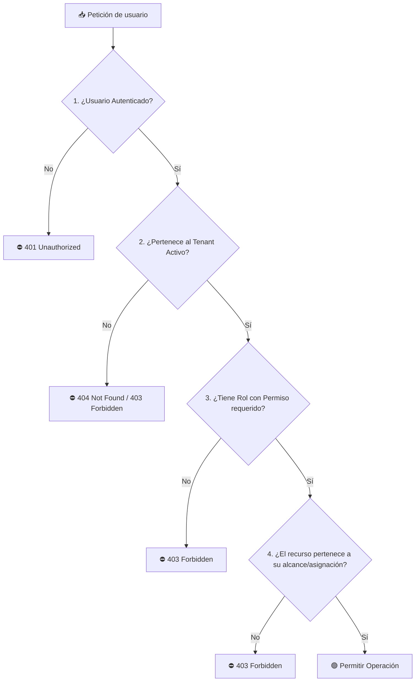
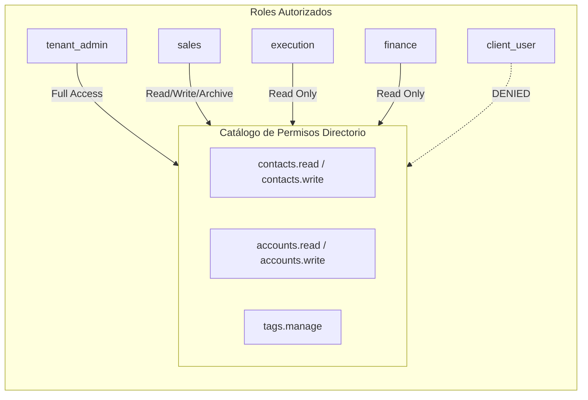

# 🔐 Roles y Permisos (Modelo RBAC y Autorización)

---

## 🎯 Objetivo de Aprendizaje

Al finalizar la lectura de este documento, serás capaz de:

1. Comprender la diferenciación entre **Roles de Plataforma**, **Roles de Empresa (Tenant)** y el **Rol de Cliente Final**.
2. Explicar el principio de **Denegación por Defecto (Default Deny)** y el cálculo del permiso efectivo.
3. Evaluar la matriz de acceso del **Directorio Comercial** y áreas protegidas para evitar filtraciones de datos (IDOR).

---

## 💡 Modelo Mental y Analogía

> **El Edificio Corporativo con Tarjetas de Acceso Inteligentes**  
> Imagina un edificio de oficinas moderno:
>
> - **Administrador de Plataforma (`platform_admin`)**: Es el dueño del edificio. Puede supervisar el mantenimiento de la estructura y áreas comunes (métricas del sistema), pero **no tiene llave para entrar a las oficinas privadas de los inquilinos** sin ser invitado.
> - **Owner / Admin de Empresa (`company_owner` / `company_admin`)**: Es el director general de su oficina privada. Controla quién entra a su piso y asigna tarjetas de acceso a sus empleados.
> - **Equipo (Ventas, Ejecución, Finanzas)**: Empleados con tarjetas reprogramadas. El ejecutivo de ventas puede abrir la sala de juntas comerciales, el de finanzas entra a la caja fuerte, y el de producción entra al taller creativo.
> - **Cliente (`client_user`)**: Visita la sala de recepción virtual (Portal). Solo puede ver los proyectos y entregables que su anfitrión ha colocado explícitamente en la mesa de presentación.

---

## 🗺️ 1. Flujo de Evaluación de Permiso Efectivo

Ocultar un botón en el frontend **no es seguridad**. El backend evalúa 4 factores en cada petición HTTP o llamada a caso de uso:

---

## 🗺️ 2. Matriz General de Permisos

| Ámbito         | Rol              | Lectura                                     | Creación / Edición                | Aprobación / Exportación           | Administración                       |
| :------------- | :--------------- | :------------------------------------------ | :-------------------------------- | :--------------------------------- | :----------------------------------- |
| **Plataforma** | `platform_admin` | Tenants y métricas agregadas                | Tenants, dominios y planes        | Exportes auditados de plataforma   | Plataforma y auditoría global        |
| **Empresa**    | `company_owner`  | Todos los datos del tenant                  | Configuración y recursos          | Aprobaciones y exportes del tenant | Membresías, marca e integraciones    |
| **Empresa**    | `company_admin`  | Datos autorizados del tenant                | Recursos y configuración delegada | Aprobaciones delegadas             | Usuarios y procesos delegados        |
| **Equipo**     | `sales`          | Prospectos, oportunidades y chats asignados | Seguimiento, citas y cotizaciones | Enviar cotizaciones a clientes     | Sin administración global            |
| **Equipo**     | `delivery`       | Proyectos, tareas, contenido y entregables  | Producción y entregables          | Revisión interna de piezas         | Sin secretos ni métricas financieras |
| **Equipo**     | `finance`        | Cotizaciones, pagos y facturas              | Pagos y registros de facturas     | Confirmar cobros y exportes        | Sin conversaciones privadas          |
| **Cliente**    | `client_user`    | Proyectos y piezas compartidas              | Comentarios y archivos propios    | Aprobar o rechazar piezas visibles | Su propio perfil de usuario          |

---

## 🗺️ 3. Permisos Específicos del Directorio Comercial

El catálogo central del directorio utiliza los prefijos `contacts.*`, `accounts.*` y `tags.*`.

| Rol              | Contactos y Cuentas              | Notas Internas  | Preferencias   | Etiquetas    |
| :--------------- | :------------------------------- | :-------------- | :------------- | :----------- |
| `tenant_admin`   | Todos los permisos               | Todas las notas | Administra     | Administra   |
| `sales`          | Ver, crear, actualizar, archivar | Propias         | Según política | Ver          |
| `execution`      | Solo ver                         | Crear propias   | Denegado       | Ver          |
| `finance`        | Solo ver                         | Crear propias   | Denegado       | Ver          |
| `client_user`    | **Denegado**                     | **Denegado**    | **Denegado**   | **Denegado** |
| `platform_admin` | **Sin acceso automático**        | **Denegado**    | **Denegado**   | **Denegado** |

> 🔒 **Aislamiento del Cliente Final**: El rol `client_user` nunca puede acceder a notas internas, márgenes financieros, conversaciones privadas de ventas ni datos de otros clientes.

---

## ⚠️ Mitos vs. Realidades / Errores Comunes

| ❌ Mito                                                                                               | ✅ Realidad                                                                                                                                                           |
| :---------------------------------------------------------------------------------------------------- | :-------------------------------------------------------------------------------------------------------------------------------------------------------------------- |
| **"Un `platform_admin` puede consultar la lista de clientes de cualquier empresa para dar soporte."** | **Falso.** El administrador de plataforma no tiene permisos automáticos sobre datos de negocio del tenant. Se respeta la privacidad de los inquilinos.                |
| **"Si borro el botón de 'Descargar Reporte' en la pantalla, el usuario no podrá descargar datos."**   | **Falso.** Si el endpoint en servidor no valida `export.audit`, el usuario podría invocar la API directamente. La autorización **siempre se ejecuta en el servidor**. |

---

## 🧠 Checkpoint de Autocomprobación

1. **¿Qué sucede por defecto si se solicita un recurso cuyo permiso no está explícitamente listado en el catálogo del rol?**
   - _A)_ Se concede acceso de lectura por conveniencia.
   - _B)_ Se rechaza la solicitud (Principio de Denegación por Defecto).
   - _(Respuesta correcta: B)_

2. **¿Puede un usuario con rol `delivery` ver el historial de pagos y facturación de una cotización?**
   - _Respuesta_: No. El rol `delivery` está restringido a proyectos, tareas y entregables, manteniendo los secretos y datos financieros aislados para el rol `finance` y administración.

---

## 🔗 Documentación Relacionada

- [Autenticación](../architecture/authentication.md)
- [Autorización](../architecture/authorization.md)
- [Gestión de Contactos y Cuentas](contact-and-account-management.md)
