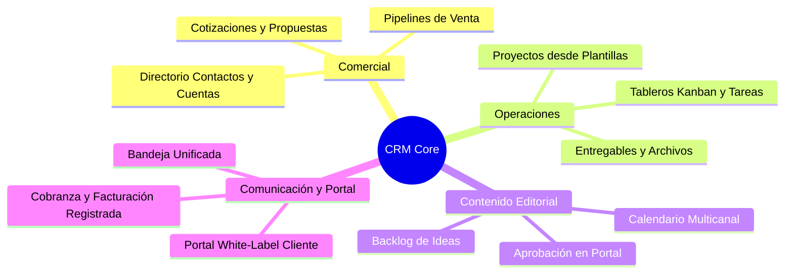
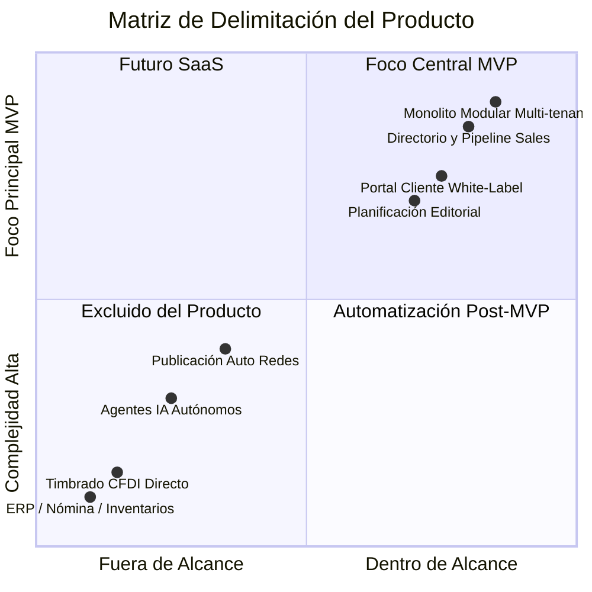

# 🎯 Visión del Producto

---

## 🎯 Objetivo de Aprendizaje

Al finalizar la lectura de este documento, serás capaz de:

1. Articular la propuesta de valor fundamental del sistema **CRM** para agencias y empresas de servicios.
2. Identificar con precisión las capacidades que están **dentro del alcance del MVP** vs. las capacidades excluidas o reservadas para fases futuras.
3. Comprender las restricciones de diseño clave (ej. no ERP, no automatización descontrolada sin supervisión).

---

## 💡 Modelo Mental y Analogía

> **El Centro de Mando Operativo de una Agencia**  
> Imagina una agencia de publicidad o servicios profesionales. Actualmente operan con 10 herramientas desconectadas: spreadsheets para ventas, Trello para entregables, WhatsApp personal para clientes, Google Drive desordenado y correos perdidos.
>
> **CRM** actúa como una **torre de control unificada**: conecta desde la primera conversación hasta el cobro final y la aprobación de contenidos, manteniendo a cada empresa (tenant) en su propio hangar privado sin mezclar jamás la información.

---

## 🗺️ 1. Declaración de Visión y Mercado Objetivo

CRM es una plataforma **multiempresa (SaaS multi-tenant)** creada para agencias de marketing, consultoras y empresas de servicios profesionales. Unifica captación, ventas, proyectos, entregables, comunicación, planificación editorial y cobranza en una sola experiencia integrada.

### 📊 Diagrama de Cobertura Funcional

---

## 🗺️ 2. Restricciones Principales y Límites Claros

Para mantener un producto enfocado, ágil y de alto valor, hemos definido límites explícitos sobre la naturaleza del sistema:

### 📊 Matriz de Alcance Estratégico

### ✅ Confirmado para el MVP

- **Monolito Modular**: Un solo core ejecutable robusto.
- **Aislamiento Multi-tenant**: Un tenant independiente por empresa con RLS a nivel base de datos.
- **White-Label**: Marca, colores y dominio configurable por empresa para su portal de clientes.
- **Supervisión Humana**: Sin agentes de IA enviando mensajes a clientes sin validación.

### 🚫 Fuera de la Visión del Producto (Lo que NO es CRM)

- **No es un ERP General**: No maneja contabilidad general, nómina, inventarios, compras ni almacenes.
- **No es una Plataforma de Cobro Fiscal Directo**: Registra facturas y cobra vía pasarelas (Stripe/Mercado Pago), pero no realiza timbrado fiscal (CFDI) directo ni custodia fondos.

---

## ⚠️ Mitos vs. Realidades / Errores Comunes

| ❌ Mito                                                                         | ✅ Realidad                                                                                                                                                           |
| :------------------------------------------------------------------------------ | :-------------------------------------------------------------------------------------------------------------------------------------------------------------------- |
| **"El CRM va a publicar automáticamente los posts en Instagram y TikTok."**     | **Falso.** En el MVP el sistema gestiona la planificación, briefs, revisiones y aprobación. La publicación automática queda reservada para integraciones posteriores. |
| **"Cualquiera se podrá registrar públicamente y pagar con tarjeta en la web."** | **Falso.** El MVP opera mediante **incorporación controlada** (onboarding manual para CRM y 2-3 empresas piloto). No hay autoregistro público.                        |

---

## 🧠 Checkpoint de Autocomprobación

1. **¿Por qué el sistema no incluye módulos de nómina e inventarios?**
   - _Respuesta_: Porque el producto está delimitado estrictamente como un CRM y gestor operativo para empresas de servicios profesionales, no como un ERP administrativo general.

2. **¿Cómo se garantiza la privacidad del cliente en el envío de mensajes por IA?**
   - _Respuesta_: Mediante la regla de diseño que prohíbe agentes IA autónomos respondiendo sin supervisión humana.

---

## 🔗 Documentación Relacionada

- [Alcance del MVP](mvp-scope.md)
- [Flujos Principales](core-workflows.md)
- [Contexto del Sistema](../architecture/system-context.md)
